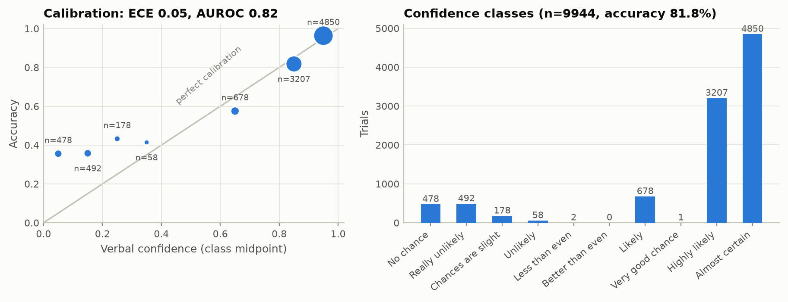
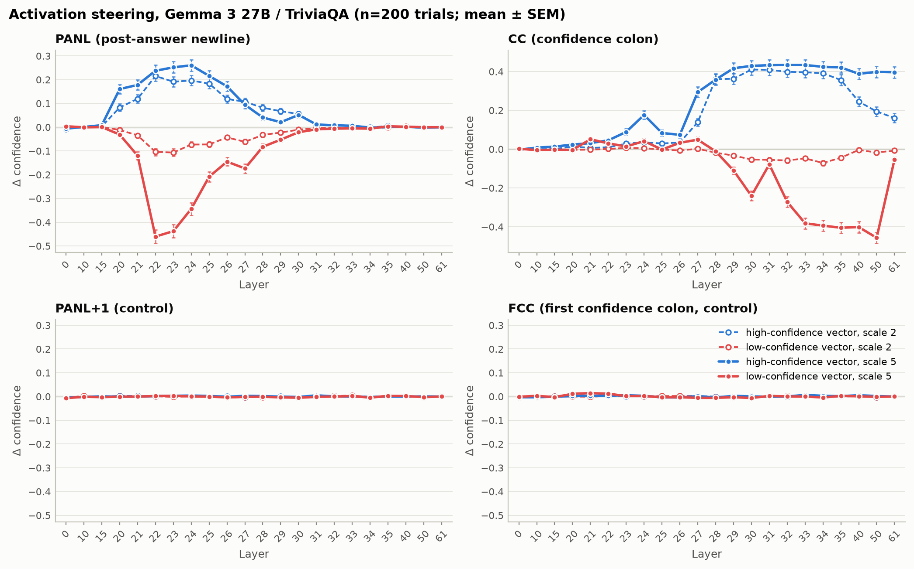
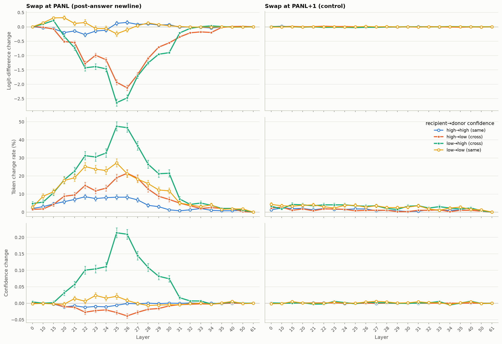
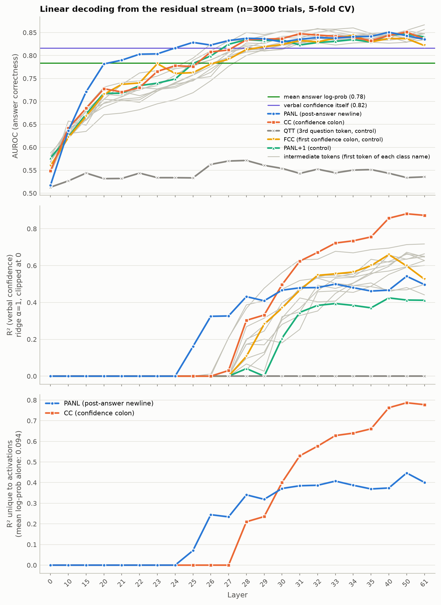
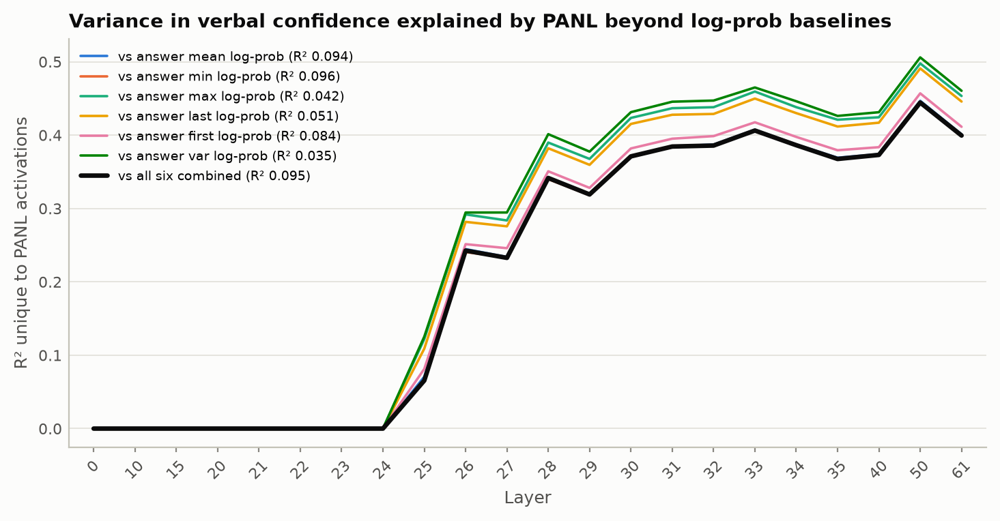

# Replication: "How do LLMs Compute Verbal Confidence?" — Gemma 3 27B on TriviaQA

Replication of the main Gemma 3 27B results of Kumaran, Conmy, Barbero, Osindero, Patraucean & Veličković,
*How do LLMs Compute Verbal Confidence?* ([arXiv:2603.17839v4](https://arxiv.org/abs/2603.17839), ICML 2026):
behaviour and calibration, activation steering, patching, noising, activation swaps, linear decoding with
variance partitioning against log-probabilities, the answer-colon controls, and attention blocking.
The paper released no code; everything here is re-implemented from its text and figures. This is an
independent replication and is not affiliated with the paper's authors.

## Bottom line

Both of the paper's claims hold for Gemma 3 27B on TriviaQA.

1. **Cached retrieval.** Confidence is represented at the first token after the answer (the post-answer newline,
   PANL) around layers 20–28 and only reaches the token that verbalises it (the confidence colon, CC) from about
   layer 30. Steering, patching, noising, swaps, decoding and attention blocking all show that ordering, and the
   adjacent control token (PANL+1) shows nothing.
2. **More than log-probabilities.** PANL activations explain about 0.4 of the variance in verbal confidence beyond
   six answer log-prob summaries (which together explain 0.10), and the answer-colon position that produces the
   answer is causally inert for confidence.

| Paper result (Gemma 3 27B, TriviaQA) | Replicated? | Paper | Here |
|---|---|---|---|
| Steering at PANL moves verbal confidence in layers 21–25; at CC from ≈ L28; control tokens do nothing (Fig. 2) | Yes | PANL scale 5: ≈ +0.17 / −0.22 @ L24–26; CC: ≈ +0.46 / −0.42 @ L30–35; controls < 0.01 | PANL: +0.26 @ L24 / −0.46 @ L22; CC: +0.43 @ L32 / −0.46; controls ≤ 0.014 |
| Patching: restoring PANL partially recovers confidence after answer corruption; CC only after L30; PANL+1 not at all (Fig. 3) | Direction yes, PANL effect about half the size | PANL logit-diff recovery ≈ 20% @ L25 | 10% @ L22 (20% of the margin to the corrupted-run class) |
| Noising: ablating PANL disrupts confidence around L25, CC after L30, controls flat (Fig. 12) | Yes | PANL ≈ 14% token change @ L25; control 3–4% | 18.5% @ L25; controls ≤ 3.5% |
| Swap: cross-confidence swaps at PANL move confidence toward the donor; same-confidence swaps do not (Fig. 5) | Yes | low→high Δconf ≈ +0.21 @ L26 | +0.21 @ L25 |
| Decoding: confidence decodable at PANL earlier than at CC (Fig. 6) | Yes | first layer with R² > 0.05 (ridge α = 1): PANL L25, CC L28 | PANL L25, CC L28 |
| PANL explains variance beyond log-probs (Fig. 14) | Yes | R²_unique 0.38 @ L40 (baselines: 0.10) | 0.37 @ L40, peak 0.44 @ L50 (baselines: 0.095) |
| Answer colon is causally inert and only weakly informative (Fig. 13) | Yes | tuned-ridge R² ≈ 0.2 vs ≈ 0.75 at PANL | 0.19 vs 0.78 |
| Attention blocking: answer tokens → PANL (L22–28) → CC (L30–36); CC does not read question/answer directly (Figs. 7, 21) | Yes | CC→PANL peak at windows L30–36; PANL→A at L22–28 | CC→PANL L30–34; PANL→A L22–24 |

The full side-by-side table (about 120 quantities) is in [`results/comparison.md`](results/comparison.md); raw numbers are
in `results/summary.json`.

## Setup in brief

- **Model**: `google/gemma-3-27b-it` (62 layers), bfloat16, raw-text prompts (no chat template), greedy.
- **Data**: TriviaQA `rc.nocontext` validation, 9,960 unique questions → 9,944 valid trials. 3,000 random trials
  form the activation-collection set (steering vectors, ablation means, probes); all interventions are tested
  on disjoint trials.
- **Positions**: PANL = newline token right after the answer; PANL+1 = next token (control); CC = last prompt
  token (`**:` after the final `**Confidence`); FCC = the `**:` before `$CLASS` in the instructions (control);
  AC = the `**:` before the answer.
- **Layers**: 0, 10, 15, 20–35, 40, 50, 61 (residual stream after each block), as in the paper.
- **Metrics**: confidence = midpoint of the argmax class; logit difference = clean class minus the mean of the
  other nine; token change rate = argmax class differs from the reference run.

Details, and every judgement call I had to make where the paper is silent, are in
[Methods and deviations](#methods-and-deviations).

## Results

### Behaviour (paper Fig. 9)



9,944 of 9,960 trials are valid, and in all of them the next token after the prompt is the first token of a
confidence class. Accuracy is 81.8% (73.1% by alias matching alone; paper: 77.4% with a GPT-4o-mini grader).

| | ECE | AUROC | "Almost certain" / "Highly likely" | bottom-3 classes |
|---|---|---|---|---|
| Paper (Fig. 9) | 0.12 | 0.71 | 69% / 21% | 6.0% |
| Here, Phase 0 (confidence stated in the same generation as the answer) | 0.09 | 0.72 | 76% / 19% | 2.4% |
| Here, Phase 1 (answer fed back in the Fig. 8 prompt; the setting all experiments use) | 0.05 | 0.82 | 49% / 32% | 11.5% |

The paper's behavioural numbers match my Phase-0 confidence; the Phase-1 confidence is better calibrated and more
discriminating here than the figures the paper reports. Mean answer log-prob predicts correctness with AUROC 0.80
(paper 0.75) and correlates r = 0.33 with Phase-1 confidence (paper 0.29); Phase-0 and Phase-1 confidence
correlate r = 0.59 (paper 0.63).

### Activation steering (Figs. 2, 11, 13a, 29)



A confidence direction (mean of 25 "Almost certain" minus mean of 25 "No chance" trials, all answered
correctly) is added at one (position, layer) with a norm of scale × 3% of the residual norm. On 200 balanced
test trials (baseline confidence 0.52; paper 0.55):

| Peak change in confidence (high vector / low vector) | Paper | Here |
|---|---|---|
| PANL, scale 2 | ≈ +0.16 / −0.09 @ L24–25 | +0.22 @ L22 / −0.11 @ L23 |
| PANL, scale 5 | ≈ +0.17 / −0.22 @ L24–26 | +0.26 @ L24 / −0.46 @ L22 |
| CC, scale 2 | ≈ +0.42 @ L31 / −0.11 | +0.41 @ L30 / −0.07 @ L34 |
| CC, scale 5 | ≈ +0.46 / −0.42 @ L30–35 | +0.43 @ L32 / −0.46 @ L50 (−0.38 to −0.41 @ L33–40) |
| PANL+1 and FCC (controls), scale 5, any layer | below 0.01 | at most 0.007 and 0.014 |

PANL can be steered only in layers 20–30 (strongest at 22–25, nothing from L31 on); CC only from L27–28, and
there the effect persists to the last layer. The low-confidence vector is about twice as effective at PANL as
in the paper: at L22 it lowers high-confidence trials by 0.85 on average. The high vector is limited by the
ceiling (high-confidence trials cannot rise); on low-confidence trials alone it adds +0.49 at L24.

Steering the **last answer token** works (+0.37 / −0.39; paper ≈ ±0.3) and steering the **first answer token**
barely does once single-token answers, where the two coincide, are excluded (+0.10 / −0.06 on 147 multi-token
answers). The **answer colon** stays within 0.05 with no consistent sign (`figures/fig11_13a_steering_answer_tokens_AC.png`,
all three on one scale). Scales 1 and 10 are in `figures/fig29_steering_scales_1_10.png`: scale 1 gives the same
profile at smaller size; at scale 10 the effects stop growing and, at CC before L27 where the class difference
is 0.3% of the residual norm, become erratic.

### Activation patching (Fig. 3)


Replacing the answer-token embeddings by calibration-set means drives all 200 high-confidence trials to the
lowest classes (197 "No chance", 3 "Really unlikely"; logit difference 14.8 → −0.53; paper 11.9 → −0.5).
Restoring the clean residual at a single (position, layer):

- **PANL** partially recovers in layers 20–27 (peak logit-difference recovery 10% at L22; paper ≈ 20% at L25).
- **CC** recovers nothing up to L30, then rises: 39% of confidence at L35, 98% at L40 (paper ≈ 22% and ≈ 95%).
- **PANL+1** recovers nothing at any layer (paper: −1.4%).

The PANL effect is smaller than in the paper, and much smaller in the thresholded confidence metric (0.13 vs
0.38). The reason is visible in the logits: in my runs corruption makes "No chance" beat the clean class by 14
logits. Patching PANL at L22 halves that margin (−14.1 → −7.7, i.e. 20% of the way back to the clean margin of
+17.2) by raising all nine other classes together, which is rarely enough to flip the argmax and moves the
"clean class minus mean of alternatives" metric only modestly.

### Activation noising (Fig. 12)


Mean-ablating one (position, layer) on 400 trials: PANL peaks at 18.5% token change at L25 with a logit-difference
drop of −1.04 at L26 (paper ≈ 14% and ≈ −0.9, same layers); CC is flat until L30, then 22% at L35 and 71% at L40
(paper 19% and 71%); PANL+1 and the answer colon never exceed 3.5% (paper 3–4%). The PANL effect comes mostly
from low-confidence trials (31.5% of them change at L25, against 5.4% of high-confidence trials).

### Activation swap (Figs. 5, 20)



PANL activations from a length-matched donor trial are transplanted into a recipient (400 high- and 400
low-confidence recipients). Cross-confidence swaps move confidence toward the donor, same-confidence swaps do not:

| at PANL, peak layer 25–26 | Paper | Here |
|---|---|---|
| low recipient ← high donor: confidence change | ≈ +0.21 | +0.21 |
| high recipient ← low donor: confidence change | ≈ −0.065 | −0.038 |
| same-confidence swaps: confidence change | ≈ ±0.02 | ≤ ±0.02 |
| token change, low←high vs low←low | ≈ 37% vs 13% | 47.5% vs 27.3% |
| token change, high←low vs high←high | ≈ 28% vs 16% | 21.5% vs 8.2% |

At CC the same directional transfer appears only from L31 (low←high +0.26 at L31; +0.79 / −0.79 by the last
layers; paper ≈ +0.68 / −0.65), and at PANL+1 nothing happens (|Δconfidence| ≤ 0.006; right-hand column above, same
y-scale). CC is in `figures/fig20_swap_CC.png`.

### Decoding and variance partitioning (Figs. 6, 14, 13d)



Linear probes on 3,000 trials (5-fold CV). With the paper's ridge setting (α = 1, which over-fits until the
signal is strong) verbal confidence becomes decodable at PANL from L25 and at CC from L27–28 — the same layers
as in the paper — and CC ends higher (peak R² 0.88 at CC against 0.54 at PANL; paper 0.84 and 0.48).
Correctness AUROC from PANL reaches 0.78 at L20 and 0.84–0.85 from L28 (paper 0.75 and 0.83–0.84); the third
question token stays at 0.51–0.57 (paper ≈ 0.57).

Answer log-probabilities explain little of the verbal confidence: R²_CV = 0.094 (mean), 0.096 (min), 0.084
(first), 0.051 (last), 0.042 (max), 0.035 (variance), 0.095 (all six) — paper 0.084, 0.101, 0.070, 0.039, 0.025,
0.051, 0.100. PANL activations add R²_unique = 0.37 at L40 beyond all six (paper 0.38), peaking at 0.44 at L50;
CC adds 0.79 (paper ≈ 0.76).



### Answer colon (Sec. 2.7, Fig. 13)

The token that produces the answer does not carry the confidence signal: steering it changes confidence by at
most 0.05 with no consistent sign, mean-ablating it changes at most 3.5% of tokens (same as PANL+1), and a ridge probe with its penalty tuned on the training folds
reaches R² = 0.19 there against 0.78 at PANL and 0.74 at PANL+1 (paper ≈ 0.2, 0.75, 0.70;
`figures/fig13d_decoding_AC.png`). Restoring AC in the patching experiment is a no-op by construction (it
precedes the corrupted tokens) and reproduces the corrupted run exactly.

### Attention blocking (Figs. 7, 21)


Attention edges are knocked out in 12 consecutive layers on a minimal 0–9 confidence prompt (500 trials).
Blocking PANL's attention to the answer tokens hurts most in windows centred on layers 22–24; blocking CC's
attention to PANL hurts most in windows centred on layers 30–34; blocking CC's attention to the question and
answer tokens does nothing beyond the PANL+1 control. That is the paper's ordering (22–28, then 30–36) and its
conclusion: answer tokens → PANL → CC, with no just-in-time computation at CC.

The size of the effect depends on how the prompt ends, which the paper's Fig. 16 leaves ambiguous, so all four
variants were run:

| Minimal prompt variant | Clean logit diff | CC→PANL: peak Δ logit diff / token change | PANL→A: peak Δ logit diff / token change | CC→PANL+1 control: peak token change (windows ≥ L20) | CC→Q+A, windows L20–45: peak token change / Δ logit diff |
|---|---|---|---|---|---|
| Paper (Fig. 7) | not given | ≈ −0.8 / 21% @ L30–36 | ≈ −0.5 / 20% @ L22–28 | ≈ 10% | ≈ 10–12% / ≈ −0.25 |
| ends `**:'`, separator `\n\n` (figure above) | 8.7 | −1.91 @ L30 / 6% @ L30 | −2.22 @ L24 / 5% @ L24 | 1% | 2% / −0.16 |
| ends `**:'`, separator `\n` | 8.4 | −1.92 @ L34 / 8% @ L30 | −1.84 @ L24 / 6% @ L24 | 2% | 1% / −0.06 |
| ends `**:`, separator `\n\n` | 4.4 | −0.48 @ L30 / 42% @ L30 | −0.61 @ L22 / 37% @ L22 | 9% | 9% / −0.10 |
| ends `**:`, separator `\n` | 4.6 | −0.73 @ L30 / 55% @ L32 | −0.48 @ L24 / 23% @ L22 | 10% | 12% / −0.12 |

The four rows agree on where the effects sit. With the trailing quote the digit is the model's actual next token
and 97% of clean answers are "9" with large margins, so few argmax digits flip although the logit shifts are
large. Without it the model's next token is usually a space and the digit logits at CC have small margins; the
numbers then come out near the paper's, closest for the single-newline form (CC→PANL −0.73 vs ≈ −0.8, PANL→A
−0.48 vs ≈ −0.5, control 10% vs ≈ 10%), which is probably what the paper used. In the two no-quote variants
the earliest windows are noisy: in the first two (layers 4–20) even the control edge changes 13–20% of digits,
and blocking CC's attention to the answer tokens changes 25–30% in the first window and 8–15% in the last two
(figures for all variants: `figures/fig07_attention_blocking_minimal_*.png`).

On the categorical prompt, with edges blocked in all layers (500 trials):

| Blocked edges | Paper (Fig. 21) | Here |
|---|---|---|
| CC → PANL+1 (control) | ≈ 10% | 0.8% |
| CC → PANL / answer / question / question+answer | ≈ 9–12% | 2.8% / 2.0% / 1.2% / 2.8% |
| all later tokens → PANL | ≈ 18% | 13.6% |
| all later tokens → last answer token | ≈ 51% | 61.4% |
| … but PANL keeps its edge to the last answer token | ≈ 24% | 24.4% |
| all later tokens → all answer tokens | ≈ 68% | 64.6% |
| … but PANL keeps its edges to the answer tokens | ≈ 51% | 30.8% |

CC alone does not need the question or answer tokens, the answer tokens are the source of the signal, and
letting only PANL read them restores most of the behaviour. The paper's ≈ 10% for the control and all CC-only
conditions is ≈ 1–3% here; my change rates are measured against unedited rows computed in the same forward
pass, which removes the numerical noise that otherwise flips 1–5% of tokens (see deviation 5).

### Interventions stay in distribution (Table 1)

Cosine similarity and norm ratio between clean and perturbed activations at layer 25, against the natural
trial-to-trial spread, agree with the paper's Table 1 to within 0.02 at both PANL and PANL+1 (for example
steering at PANL, scale 5: cosine 0.994 / norm ratio 0.89 for the high vector, paper 0.992 / 0.91). As in the
paper, PANL and PANL+1 are perturbed equally and only PANL changes the output.

### Robustness checks

Two choices could plausibly matter for the size of the PANL effects, so they were varied (all else unchanged).

| Patching run | Clean confidence / logit diff | PANL: peak logit-diff recovery | PANL: peak confidence recovery | PANL: lowest token change | CC: confidence recovery @ L30 / L35 / L40 | PANL+1: largest logit-diff recovery |
|---|---|---|---|---|---|---|
| Paper (Fig. 3) | ≈ 0.68 / 11.9 | ≈ 20% @ L25 | ≈ 40% @ L25 (confidence 0.38) | ≈ 78% | ≈ 0% / 22% / 95% | ≈ 0% |
| Main run: Phase-1 top-3 trials, separator `\n\n` | 0.92 / 14.8 | 10.4% @ L22 | 9.2% @ L22 (confidence 0.13) | 96% | 0% / 39% / 98% | 0.1% |
| Same trials, separator `\n` | 0.92 / 14.7 | 10.7% @ L22 | 14.2% @ L26 (confidence 0.17) | 92% | 0% / 37% / 98% | 0.2% |
| Trials chosen by Phase-0 confidence (as in the paper), separator `\n\n` | 0.82 / 13.2 | 11.6% @ L22 | 16.4% @ L22 (confidence 0.18) | 89% | 0% / 35% / 99% | 0.2% |

- **Separator after the answer.** With a single `\n` as the PANL token instead of `\n\n`, patching (table),
  noising and attention blocking give the same picture. Noising PANL peaks at 22.2% token change at
  L26 (main run 18.5% at L25), with PANL+1 at most 4.0% and the answer colon at most 4.8%.
  With all layers blocked, cutting every later token off from the last answer token changes 60% of
  tokens (main run 61%), 20% if PANL keeps its edge (24%), and blocking CC→question+answer
  changes 5.6% (2.8%).
- **How patching trials are chosen.** The paper selects its 200 "high-confidence" patching trials by Phase-0
  confidence, and their clean Phase-1 confidence is only about 0.68 (the L61 point of the CC curve in its
  Fig. 3, which by construction equals the clean run). On 200 trials selected the same way (clean confidence
  0.82) PANL patching peaks at 11.6% logit-difference recovery and 16.4% confidence recovery at L22.

Neither choice explains why PANL patching is weaker here than in the paper.

## Differences from the paper

Where my numbers differ from the paper's by more than noise:

1. **Behavioural statistics.** The paper's Fig. 9 (ECE 0.12, AUROC 0.71, 69% "Almost certain") matches my
   Phase-0 confidence (0.09, 0.72, 76%), not the Phase-1 confidence that the mechanistic experiments act on
   (0.05, 0.82, 49%). Either Fig. 9 reports Phase 0, or the paper's Phase-1 prompt behaves differently from my
   reconstruction. As a consequence verbal confidence predicts correctness better than mean log-prob here (0.82 vs
   0.80), the reverse of the paper (0.71 vs 0.75).
2. **Patching at PANL is weaker.** Logit-difference recovery peaks at about 10% (paper ≈ 20%) and the confidence
   metric barely moves (0.13 vs 0.38), because corruption pushes my runs to "No chance" by a 14-logit margin
   that a single-position patch halves but rarely overturns. Neither the newline variant nor the way the trials
   are selected closes the gap (see Robustness checks).
3. **Steering with the low-confidence vector at PANL is stronger** (−0.46 vs ≈ −0.22 at scale 5), and the PANL
   peak sits at layers 22–24 rather than 24–26.
4. **Same-confidence swap controls** differ in level: 27% of tokens change for low←low swaps (paper ≈ 13%) and
   8% for high←high (paper ≈ 16%). The cross-minus-same differences are similar (20 and 13 points here, ≈ 24
   and 12 in the paper), and the confidence shifts match.
5. **Control levels in attention blocking.** The paper's control and CC-only conditions sit at ≈ 10% token
   change; mine are at ≈ 1–3% on the categorical prompt because changes are measured against unedited rows in
   the same forward pass. On the minimal prompt the size of every effect depends on the prompt ending.
6. **Late-layer decodability at control tokens** is higher than in the paper (ridge α = 1: PANL+1 0.42 and FCC
   0.66 at L40, paper ≈ 0.3 and ≈ 0.4), and the unique variance at PANL peaks at L50 (0.44) rather than L40.

Not attempted: the numeric 0–100 prompt, BigMath, MMLU, Qwen 2.5 7B and Magistral Small (Sec. 2.9).

## Methods and deviations

All experiments use `google/gemma-3-27b-it` (62 layers, d = 5376) in bfloat16 through Hugging Face
`transformers` 5.1, split over two A40 GPUs, greedy decoding, TriviaQA (`rc.nocontext`, validation, 9,960
unique questions after de-duplication). Section numbers refer to arXiv:2603.17839v4.

### Reproduced as described

| Paper | Implementation |
|---|---|
| Prompts (Figs. 8, 16) | `src/vc/prompts.py`. Fed as raw text (`<bos>` + prompt, no chat template), so the confidence colon (CC) is the literal last prompt token and the answer colon (AC) is the last token of the Phase-0 prompt, as the paper describes. All 9,944 valid trials produce a confidence-class first token. |
| Phase 0 / Phase 1 (C.1.2) | Phase 0: confidence instructions first, prompt ends at `**Answer**:`; the model generates the answer and a confidence class; answer-token log-probs are recorded. Phase 1: the answer is inserted into the Fig. 8 prompt and the class is read from the next-token logits at CC. |
| Positions | PANL = the newline token directly after the answer, PANL+1 = next token (`Class`), CC = final `**:` token, FCC = the `**:` before `$CLASS`, AC = the `**:` before the answer, first/last answer token, QTT = third question token, and the first token of each class name in the instruction list ("intermediate tokens"). |
| Layers (C.1.3) | 0, 10, 15, 20–35, 40, 50, 61; "layer l" = residual stream after block l. |
| Steering (C.1.3) | v = mean(25 highest-confidence) − mean(25 lowest-confidence) correctly answered trials of the 3,000-trial collection set (all 25 low trials are "No chance", all 25 high "Almost certain"); added at one (layer, position) with norm α · 3% · (mean residual norm there), α ∈ {2, 5} (also 1, 10); 200 test trials (100 from the top-3 classes, 100 from the bottom-3), disjoint from the collection set. |
| Patching (C.1.4) | Answer-token *embeddings* replaced by the per-answer-position mean embedding of 100 calibration trials (50 high / 50 low); clean residual restored at one (layer, position); 200 high-confidence trials. |
| Noising (C.1.6) | Residual at one (layer, position) replaced by the mean over the same 100 calibration trials; 400 trials (200 high / 200 low). |
| Swap (C.1.7) | 2 × 2 design, 400 high and 400 low recipients, donors matched on question- and answer-length quantile bins (100% bin matches; mean \|ΔL_Q\| 2.3–2.8, \|ΔL_A\| 0.4–0.5 tokens — the paper reports 1.5–2.7 and 0.3–0.5). |
| Decoding (C.1.8, C.1.9) | 5-fold CV on the 3,000-trial collection set, z-scored features; logistic regression (C = 1) → AUROC for correctness; ridge (α = 1) → R² for the confidence midpoint; R²_unique = max(0, R²_both − R²_base) against each of six answer log-prob summaries and all six combined. |
| Attention blocking (C.1.10) | Pre-softmax knockout of attention edges in all heads (Geva et al., 2023): 12-layer windows on the minimal 0–9 prompt (500 trials), all layers on the categorical prompt (500 trials). |
| Metrics (C.1.5) | Confidence = midpoint of the argmax class; logit difference = clean class minus mean of the other nine; token change rate = argmax class differs from the reference run. |

### Deviations and judgement calls

1. **Grader.** The paper marks answers with GPT-4o-mini. Here an answer is correct if it matches a TriviaQA alias
   (official normalisation) *or* Gemma 3 27B itself, shown the question, the reference aliases and the answer,
   says "Yes" (first-token logit of Yes vs No). On a hand-checked random sample of 70 answers that failed alias
   matching but were accepted by the grader, about 66 were genuinely correct (the alias lists are noisy), so
   alias matching alone (73.1%) under-counts and the combined label (81.8%) is the better estimate. Correctness
   labels only enter the behavioural statistics, the choice of steering-vector trials and the correctness probe.
2. **Phase-0 prompt wording.** The paper only says it is "essentially identical" to Fig. 8 with the confidence
   instructions first; the wording in `prompts.py` is my reconstruction.
3. **Newline after the answer.** Fig. 8 draws `\n` on its own line, which can be read as one, two or three
   newlines. I use a blank line (`\n\n`, a single Gemma token), consistent with the layout of Fig. 15. A pilot on
   600 questions showed near-identical behaviour for the three variants, and patching / noising / attention
   blocking were re-run with a single `\n` (see Robustness checks).
4. **Minimal 0–9 prompt.** With the prompt ending in `**:` Gemma's next token is a space in 77–93% of trials
   (digits have no space-prefixed tokens), so the digit is not the model's actual next token. Fig. 16 literally
   ends in `**:'`; with that trailing quote the next token is a digit in 100% of trials. Because the paper's
   exact string cannot be recovered from the figure, attention blocking was run on all four variants
   (ending `:'` or `:`, separator `\n\n` or `\n`), always reading the ten digit logits at the last prompt token.
5. **Numerical-noise control (not in the paper).** bf16 logits move by up to ~0.8 when the same rows are run in a
   different batch shape, enough to flip 1–3% of argmax classes. Every intervention pass therefore also carries
   unedited copies of the same rows, and all "change" metrics are computed against those same-pass copies
   (identical rows in one pass are bit-identical; verified in `scripts/numtest.py`). Final-layer norm and
   unembedding of the class tokens are evaluated in float32.
6. **Efficiency.** An intervention at layer l is computed by resuming the forward pass from the cached residual
   stream after block l (bit-identical to editing inside a full pass; verified in `scripts/pilot.py`).
7. **"Best alpha" ridge.** For the Fig. 13d-style analysis the ridge penalty is chosen on each training fold by
   closed-form leave-one-out error from a grid of 10 values (the paper reuses the best alpha found at AC).
8. **Fig. 13b (patching AC).** With corruption applied to input embeddings, the AC token (always `**:`) is
   unchanged by mean-ablation and precedes the corrupted answer tokens, so restoring AC is a no-op by causality.
   This is included only as a sanity check (it reproduces the corrupted run exactly).

## Layout

| Path | Content |
|---|---|
| `src/vc/prompts.py` | Prompts (paper Figs. 8, 15, 16) and token-position bookkeeping |
| `src/vc/model.py` | Gemma 3 27B wrapper with an explicit layer loop: capture, resume-from-layer, attention-edge blocking |
| `scripts/behav.py`, `merge_behav.py` | Phase 0 answers + log-probs, grading, Phase 1 confidence; trial table, splits, trial sets, swap donor matching |
| `scripts/collect.py`, `prep_vectors.py` | 3,000-trial activation collection; steering vectors, ablation means, OOD reference statistics |
| `scripts/interv.py` | Steering, patching, noising, swap, attention blocking (sharded over four two-GPU jobs) |
| `scripts/probe.py` | Linear decoding and variance partitioning |
| `scripts/analyze.py`, `report.py` | `figures/`, `results/summary.json`, `results/comparison.md` |
| `scripts/pilot.py`, `pilot2.py`, `numtest.py` | Engine validation, prompt-format pilot, numerical-noise test |
| `data/` | `trials.jsonl` (9,944 trials with answers, labels, confidence, log-probs), trial sets, swap plan |
| `results/` | Raw outputs of every experiment (`<experiment>/shard*.pt`, `behav/shard*.jsonl`, `probe/probe.json`, `vectors.pt`), `summary.json`, `comparison.md` |
| `figures/` | All figures |

Everything `analyze.py` and `report.py` read is in the repository, so the figures and tables can be rebuilt
without a GPU. Not included: the collected activations (`results/acts`, 12.8 GB), which `collect.py`
regenerates and only `prep_vectors.py` and `probe.py` read.

`data/trials.jsonl` and `results/behav/` contain TriviaQA questions and reference answers (Joshi et al., 2017;
[mandarjoshi90/triviaqa](https://github.com/mandarjoshi90/triviaqa), Apache 2.0) next to the outputs of
`google/gemma-3-27b-it`.

## Reproducing

```bash
pip install -r requirements.txt       # Python 3.11; the versions the reported runs used

# Figures and tables only (no GPU): figures/, results/summary.json, results/comparison.md
python scripts/analyze.py && python scripts/report.py

# Full pipeline. The model is gated: set HF_TOKEN in the environment or in ~/.env.
python scripts/download.py            # caches google/gemma-3-27b-it (55 GB) and TriviaQA

# GPU steps are split into shards: run each one with --shard 0, 1, 2, 3. A shard holds one bf16 copy of the
# model on two 48 GB GPUs. scripts/job.sh wraps a step for a Slurm array (the shard is the array task id).
python -u scripts/behav.py   --shard $K --nshards 4    # ≈ 27 min per shard
python    scripts/merge_behav.py                       # data/trials.jsonl, data/sets.json, data/swap_plan.json
python -u scripts/collect.py --shard $K --nshards 4    # ≈ 3 min per shard; writes results/acts
python -u scripts/prep_vectors.py                      # CPU, ≈ 1 min, 40 GB RAM
# main interventions, ≈ 2 h 50 min per shard
python -u scripts/interv.py  --shard $K --nshards 4 \
    --exp patch,noise,attn_cat,attn_min_pmq,attn_min_pm,swap,steer,attn_min_pmq1,attn_min_pm1
python -u scripts/probe.py --jobs 4                    # CPU, ≈ 1 h 45 min on 4 cores, 40 GB RAM
# robustness runs, ≈ 33 and ≈ 10 min per shard
python -u scripts/interv.py  --shard $K --nshards 4 --exp patch,noise,attn_cat --panl-n 1 --tag _nl1
python -u scripts/interv.py  --shard $K --nshards 4 --exp patch --set patch_p0 --tag _p0
python scripts/analyze.py && python scripts/report.py
```

Times are for 2 × A40 per shard (≈ 5.8 full forward passes per second). `interv.py` skips a shard whose output
already exists, so an interrupted run can be restarted; to recompute the results shipped here, delete the
experiment's folder under `results/` first.

## Compute

About 33 A40 GPU-hours, run as four two-GPU jobs in parallel: behaviour 3.7, activation collection 0.4,
interventions 22.9, robustness runs 5.6, pilots and smoke tests 0.7; plus one 1.8-hour CPU job for the probes.

