# Replication: "How do LLMs Compute Verbal Confidence?" — Gemma 3 27B on TriviaQA

Replication of the main Gemma 3 27B results of Kumaran, Conmy, Barbero, Osindero, Patraucean & Veličković,
*How do LLMs Compute Verbal Confidence?* ([arXiv:2603.17839v4](https://arxiv.org/abs/2603.17839), ICML 2026):
behaviour and calibration, activation steering, patching, noising, activation swaps, linear decoding with
variance partitioning against log-probabilities, the answer-colon controls, and attention blocking.
The paper released no code; everything here is re-implemented from its text and figures. An
[extension](#extension-two-turn-chat-format) repeats the experiments in a two-turn chat format, with the answer
in the model's own turn and the confidence request in a new user turn. A second
[extension](#extension-reading-the-post-answer-token-with-interpretability-tools) reads the post-answer token
with three released interpretability tools: a natural-language autoencoder, a sparse autoencoder and the
Jacobian lens. This is an independent replication and is not affiliated with the paper's authors.

## Bottom line

Both of the paper's claims hold for Gemma 3 27B on TriviaQA.

1. **Cached retrieval.** Confidence is represented at the first token after the answer (the post-answer newline,
   PANL) around layers 20–28 and only reaches the token that verbalises it (the confidence colon, CC) from about
   layer 30. Steering, patching, noising, swaps, decoding and attention blocking all show that ordering, and the
   adjacent control token (PANL+1) shows nothing.
2. **More than log-probabilities.** PANL activations explain about 0.4 of the variance in verbal confidence beyond
   six answer log-prob summaries (which together explain 0.10), and the answer-colon position that produces the
   answer is causally inert for confidence.

| Paper result (Gemma 3 27B, TriviaQA) | Replicated? | Paper | Here |
|---|---|---|---|
| Calibration of verbal confidence (Fig. 9) | Yes | ECE 0.12, AUROC 0.71, accuracy 77.4% | ECE 0.11, AUROC 0.72, accuracy 79.6% (confidence stated with the answer) |
| Steering at PANL moves verbal confidence in layers 21–25; at CC from ≈ L28; control tokens do nothing (Fig. 2) | Yes | PANL scale 5: ≈ +0.18 / −0.22 @ L24–26; CC: ≈ +0.46 / −0.42 @ L30–35; controls < 0.01 | PANL: +0.31 @ L22 / −0.24 @ L23; CC: +0.43 @ L30 / −0.44 @ L35; controls ≤ 0.023 |
| Patching: restoring PANL partially recovers confidence after answer corruption; CC only after L30; PANL+1 not at all (Fig. 3) | Yes, PANL effect about two-thirds the size | PANL @ L25: logit-diff recovery ≈ 20%, confidence 0.38 | PANL @ L25: 13%, confidence 0.24 |
| Noising: ablating PANL disrupts confidence around L25, CC after L30, controls flat (Fig. 12) | Yes | PANL ≈ 14% token change @ L25; control 3–4% | 18.5% @ L25; controls ≤ 3.5% |
| Swap: cross-confidence swaps at PANL move confidence toward the donor; same-confidence swaps do not (Fig. 5) | Yes | low→high Δconf ≈ +0.21 @ L26 | +0.21 @ L25 |
| Decoding: confidence decodable at PANL earlier than at CC (Fig. 6) | Yes | first layer with R² > 0.05 (ridge α = 1): PANL L25, CC L28 | PANL L25, CC L28 |
| PANL explains variance beyond log-probs (Fig. 14) | Yes | R²_unique 0.38 @ L40 (baselines: 0.10) | 0.39 @ L40, peak 0.46 @ L50 (baselines: 0.10) |
| Answer colon is causally inert and only weakly informative (Fig. 13) | Yes | tuned-ridge R² ≈ 0.2 vs ≈ 0.75 at PANL | 0.19 vs 0.78 |
| Attention blocking: answer tokens → PANL (L22–28) → CC (L30–36); CC does not read question/answer directly (Figs. 7, 21) | Yes | CC→PANL peak at windows L30–36; PANL→A at L22–28 | CC→PANL L30–34; PANL→A L22–24 |

The full side-by-side table (about 120 quantities) is in [`results/comparison.md`](results/comparison.md); raw numbers are
in `results/summary.json`.

**Extension: two-turn chat format.** When the answer is the model's own chat turn and the confidence request
arrives in a new user turn, the mechanism is still there. The answer's evaluation sits on the tokens that
close the answer turn in layers 20–28 and reaches the token that emits the class only from layer 30; patching,
steering, swaps, attention blocking and decoding agree on that. The behaviour is different: the model states
one of the bottom three classes in 0.8% of trials instead of 11.5%, and its class logits are so peaked that
lowering its confidence moves the logits but not the stated class. See
[Extension: two-turn chat format](#extension-two-turn-chat-format).

**Extension: what the post-answer token holds.** Three released interpretability tools read the same thing at
the token after the answer: a verdict on the answer, not a confidence class. The Jacobian lens reads
`Incorrect` there on low-confidence trials from layer 25, three layers before that word is readable at the
token that emits the class. Sparse-autoencoder features for "incorrect", "unfortunately" and "actually" are
active there in 81–95% of low-confidence and 7–14% of high-confidence trials. A natural-language autoencoder
describes the token as expecting "That is incorrect" or "The correct answer is..." in 85% of low-confidence
against 13% of high-confidence trials. Steering against the lens direction of `Incorrect` at that token
raises the confidence of doubted answers by 0.3. The paper's steering direction reads the same way through the
lens, but it is mostly not made of such readable parts, and up to two-thirds of its squared length is a
generic component with no effect. See
[Extension: reading the post-answer token with interpretability tools](#extension-reading-the-post-answer-token-with-interpretability-tools).

**Added test: the question corrupted too.** If the question tokens are corrupted as well as the answer
tokens, restoring PANL recovers nothing, at one layer or held clean in all of them, while restoring the
instruction tokens (layers 28–31) or CC (from layer 35) works as before. PANL still holds what is needed:
once the tokens after it are also stopped from reading the corrupted question and answer, a clean PANL brings
the confidence back to 0.81 of 0.82. With the paper's own corruption, holding PANL clean over layers 20–28
restores 0.75, three times what the single-layer patch shows. See
[Patching with the question corrupted too](#patching-with-the-question-corrupted-too).

## Setup in brief

- **Model**: `google/gemma-3-27b-it` (62 layers), bfloat16, raw-text prompts (no chat template), greedy.
- **Data**: TriviaQA `rc.nocontext` validation, 9,960 unique questions → 9,944 valid trials. 3,000 random trials
  form the activation-collection set (steering vectors, ablation means, probes); all interventions are tested
  on disjoint trials. Answers are graded by GPT-4o-mini, as in the paper.
- **Positions**: PANL = newline token right after the answer; PANL+1 = next token (control); CC = last prompt
  token (`**:` after the final `**Confidence`); FCC = the `**:` before `$CLASS` in the instructions (control);
  AC = the `**:` before the answer.
- **Layers**: 0, 10, 15, 20–35, 40, 50, 61 (residual stream after each block), as in the paper.
- **Metrics**: confidence = midpoint of the argmax class; logit difference = clean class minus the mean of the
  other nine; token change rate = argmax class differs from the reference run.

Details, and every judgement call I had to make where the paper is silent, are in
[Methods and deviations](#methods-and-deviations).

## Results

### Behaviour (paper Fig. 9)


9,944 of 9,960 trials are valid, and in all of them the next token after the prompt is the first token of a
confidence class. Graded by GPT-4o-mini, as in the paper, accuracy is 79.6% (paper 77.4%; 73.1% by alias
matching alone).

| | ECE | AUROC | "Almost certain" / "Highly likely" | bottom-3 classes | accuracy of "Almost certain" / "Highly likely" answers |
|---|---|---|---|---|---|
| Paper (Fig. 9) | 0.12 | 0.71 | 69% / 21% | 6.0% | ≈ 0.86 / 0.63 |
| Here, Phase 0 (confidence stated in the same generation as the answer) | 0.11 | 0.72 | 76% / 19% | 2.3% | 0.88 / 0.57 |
| Here, Phase 1 (answer fed back in the Fig. 8 prompt; the setting all experiments use) | 0.06 | 0.81 | 49% / 32% | 11.5% | 0.95 / 0.78 |

The paper's Fig. 9 matches the Phase-0 confidence: calibration error, AUROC and the accuracy within each class
agree, and the class shares are close. The paper does not say which phase the figure shows. When the answer
is fed back (Phase 1) the model is less confident and better calibrated here. The relations between the two
phases and the answer log-probabilities are the same as in the paper: mean answer log-prob correlates r = 0.26
with Phase-0 and r = 0.33 with Phase-1 confidence (paper 0.23 and 0.29), and the two confidences correlate
r = 0.59 (paper 0.63). Mean answer log-prob predicts correctness with AUROC 0.81 (paper 0.75).

### Activation steering (Figs. 2, 11, 13a, 29)


A confidence direction (mean of 25 "Almost certain" minus mean of 25 "No chance" trials, all answered
correctly) is added at one (position, layer) with a norm of scale × 3% of the residual norm. On 200 balanced
test trials (baseline confidence 0.52; paper 0.55):

| Peak change in confidence (high vector / low vector) | Paper | Here |
|---|---|---|
| PANL, scale 2 | ≈ +0.17 @ L25 / −0.09 @ L24–25 | +0.30 @ L24 / −0.14 @ L24 |
| PANL, scale 5 | ≈ +0.18 @ L25–26 / −0.22 @ L24 | +0.31 @ L22 / −0.24 @ L23 |
| CC, scale 2 | ≈ +0.42 @ L31 / −0.11 @ L31 | +0.39 @ L31 / −0.07 @ L30 |
| CC, scale 5 | ≈ +0.46 @ L30–33 / −0.42 @ L30 | +0.43 @ L30 / −0.44 @ L35 |
| PANL+1 and FCC (controls), scale 5, any layer | below 0.01 | at most 0.010 and 0.023 |

PANL can be steered only in layers 20–30 (strongest at 22–25, nothing from L31 on); CC only from L27–28. At CC
the curves follow the paper's layer by layer. The high vector at scale 5 keeps its effect to the last layer
(+0.38 at L61; paper ≈ +0.40) and at scale 2 fades to +0.15 (paper ≈ +0.15). The low vector at scale 5 has
almost no effect at L31 (−0.04), between −0.39 at L30 and −0.30 at L32; the paper shows the same gap (≈ −0.12
between −0.42 and −0.34).

At PANL the low vector matches the paper and the high vector is nearly twice as strong. The high vector is
limited by the ceiling, since high-confidence trials cannot rise; low-confidence trials alone gain +0.60 at
L22. The low vector lowers high-confidence trials by 0.41 at L23. How large the PANL effects are depends on
which 25 + 25 trials define the direction (see What the effect sizes depend on).

Steering the **last answer token** works (+0.32 / −0.40; paper ≈ ±0.3). Steering the **first answer token**
does less once single-token answers, where the two coincide, are excluded (+0.04 / −0.15 on 147 multi-token
answers). The **answer colon** stays within 0.08, and both vectors move it in the same direction
(`figures/fig11_13a_steering_answer_tokens_AC.png`, all three on one scale). Scales 1 and 10 are in
`figures/fig29_steering_scales_1_10.png`: scale 1 gives the same profile at smaller size; at scale 10 the
effects stop growing and jump from layer to layer, and at CC before L29, where the class difference is 0.2%
of the residual norm, their sign is not reliable.

### Activation patching (Fig. 3)

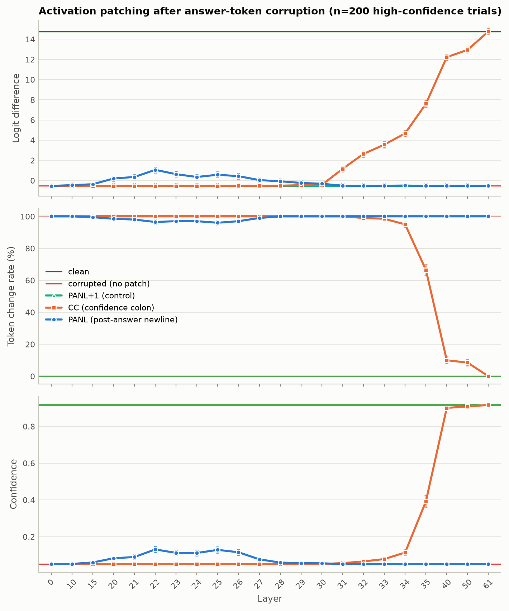

The 200 trials are those with a top-3 confidence class in Phase 0, as in the paper. Replacing the answer-token
embeddings by calibration-set means drives all of them to "No chance" (logit difference 13.2 → −0.64; paper
11.9 → −0.5). Restoring the clean residual at a single (position, layer):

- **PANL** partially recovers in layers 20–27, with a plateau over L22–26: logit-difference recovery 10–13%
  (paper ≈ 20% over L22–25), confidence 0.24 at L25 (paper 0.38), and 82% of tokens still changed at L25
  (paper 78%).
- **CC** recovers nothing up to L33, then rises: 38% of confidence at L35, 100% at L40 (paper ≈ 22% and ≈ 95%).
- **PANL+1** recovers nothing at any layer (paper: −1.4%).

The PANL effect has the paper's layers and shape at about two-thirds of its size. In the logits, corruption
makes "No chance" beat the clean class by 14 logits, and patching PANL at L25 takes that margin from −14.2 to
−5.2, 30% of the way back to the clean margin of +15.5. It does so by raising all nine other classes
together, which flips the argmax in a minority of trials. How much is recovered depends on how the corrupting
embedding is built and on the length of the answer (see Robustness checks and What the effect sizes depend
on).

Between PANL and CC the signal is carried by the instruction text. The paper suggests as much: its appendix
puts the missing CC→PANL effect on the categorical prompt down to routing "through multiple intermediate
template tokens" and leaves that routing open. A run added with the two-turn extension measures it by
restoring all 244 instruction tokens between PANL and CC together: nothing is recovered up to layer 26, and
72–95% of the confidence in layers 28–31 (see
[Two-turn patching](#two-turn-patching-where-the-signal-sits-layer-by-layer)).

### Patching with the question corrupted too

Not in the paper. The paper corrupts the answer tokens, so every later token can still read the question.
Here the question tokens are corrupted as well, or alone, by the same recipe (each embedding replaced by the
calibration-set mean at the same sequence position), on the same 200 trials.

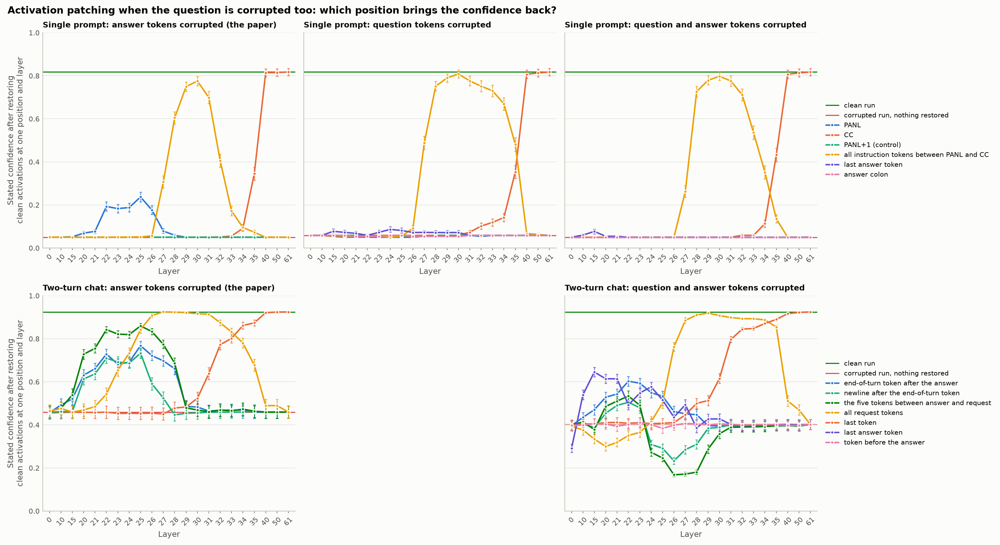

Restoring clean activations at one position and one layer (stated confidence at the best layer, with the
share of the logit difference recovered; the clean run is at 0.82):

| Corrupted tokens | Nothing restored | PANL | All instruction tokens between PANL and CC | CC | PANL+1 (control) |
|---|---|---|---|---|---|
| Answer (the paper) | 0.05 | 0.24 at L25 (13%) | 0.78 at L30 (82%) | 0.34 at L35, 0.81 at L40 | 0.05 |
| Question | 0.06 | 0.06 at every layer (0%) | 0.81 at L30 (89%) | 0.35 at L35, 0.81 at L40 | 0.06 |
| Question and answer | 0.05 | 0.05 at every layer (at most 3%) | 0.80 at L30 (85%) | 0.43 at L35, 0.81 at L40 | 0.05 |

- **Restoring CC or the instruction tokens works whatever is corrupted.** The instruction tokens bring the
  confidence back in layers 28–31 and CC from layer 35, as with the paper's corruption.
- **Restoring PANL does nothing once the question is corrupted.** The last answer token (at most 0.09) and
  the answer colon (0.06) do nothing either.

Is one layer too little? A second run holds a position at its clean activations in every layer of a range
while the rest of the corrupted pass runs:

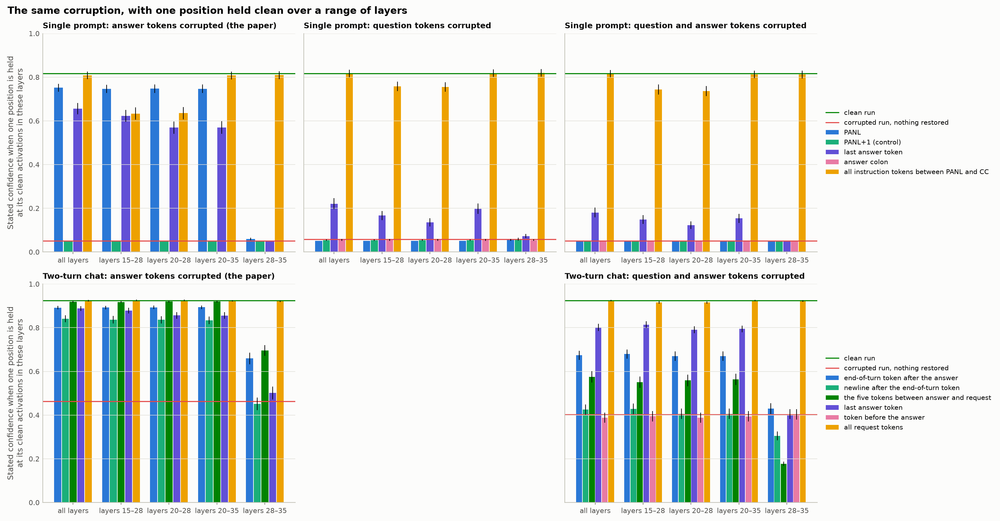

| Corrupted tokens | PANL held clean in layers 20–28 | ... in all layers | ... in layers 28–35 | PANL+1 held clean, layers 20–28 | Instruction tokens held clean, layers 20–28 |
|---|---|---|---|---|---|
| Answer (the paper) | 0.75 (68%) | 0.75 | 0.06 | 0.05 | 0.64 |
| Question | 0.05 (3%) | 0.05 | 0.05 | 0.05 | 0.76 |
| Question and answer | 0.05 (8%) | 0.05 | 0.05 | 0.05 | 0.74 |

- **With the paper's corruption, PANL held clean over layers 20–28 restores almost all of the confidence**:
  0.75 of 0.82, against 0.24 for the best single layer. The single-layer patch understates what PANL carries,
  because PANL is rewritten from the corrupted answer in the next layer.
- **With the question corrupted, PANL held clean in every layer still gives "No chance".**

That is not because the later tokens lack something only the question has. Two further runs show why.

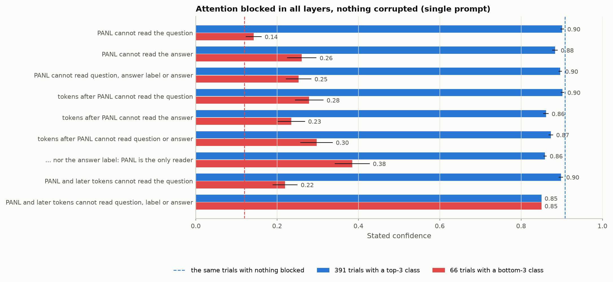

**In an unedited run the tokens after PANL do not need the question.** Attention edges blocked in all
layers, nothing corrupted, 500 trials (391 with a top-3 class, mean confidence 0.91; 66 with a bottom-3
class, 0.12):

| Blocked | Top-3 trials | Bottom-3 trials |
|---|---|---|
| Tokens after PANL cannot read the question | 0.90 | 0.28 |
| Tokens after PANL cannot read the question, the answer label or the answer: PANL is the only reader | 0.86 | 0.38 |
| PANL cannot read them, the later tokens can | 0.90 | 0.25 |
| Neither PANL nor any later token can read them | 0.85 | 0.85 |

  With nothing to go on the model says "Highly likely" for every trial: high confidence is the default and
  low confidence has to be signalled. The signal arrives by two routes, through PANL and by the later
  tokens reading the question and answer themselves, and either one alone keeps most low-confidence trials
  low (52% and 82% of them stay in a bottom-3 class).

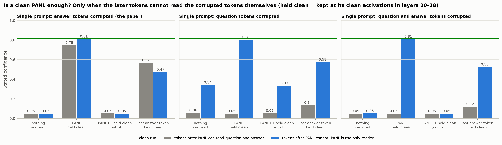

**A clean PANL is enough once the later tokens cannot read the corrupted tokens themselves.** The same
corruptions, with the tokens after PANL blocked from the question, the answer label and the answer in all
layers:

| Corrupted tokens | Nothing restored | PANL held clean, layers 20–28 | PANL+1 held clean (control) |
|---|---|---|---|
| Answer | 0.05 | 0.81 (75%) | 0.05 |
| Question | 0.34 | 0.81 (74%) | 0.33 |
| Question and answer | 0.05 | 0.81 (76%) | 0.05 |

  So PANL holds what is needed to restore the confidence to 0.81 of 0.82, and it does so even when neither
  the question nor the answer can be read by anything after it. Without the block, the later tokens read the
  corrupted question directly, that route says "No chance", and it overrules a clean PANL. A corrupted
  answer overrules it only slightly (0.75 instead of 0.81).

**Two-turn chat.** The same pattern. With question and answer corrupted the confidence falls from 0.92 to
0.40. Restoring the end-of-turn token at one layer recovers 4% of the logit difference at best (32% with the
answer alone corrupted), and the five boundary tokens 8% (54%). Held clean over layers 20–28 they recover 8%
and 26%, against 66% and 81% with the answer alone corrupted. The request tokens (0.92 at L29) and the last
token (0.92 at L40) work as before. The attention-blocking runs were made for the single prompt only.

### Activation noising (Fig. 12)

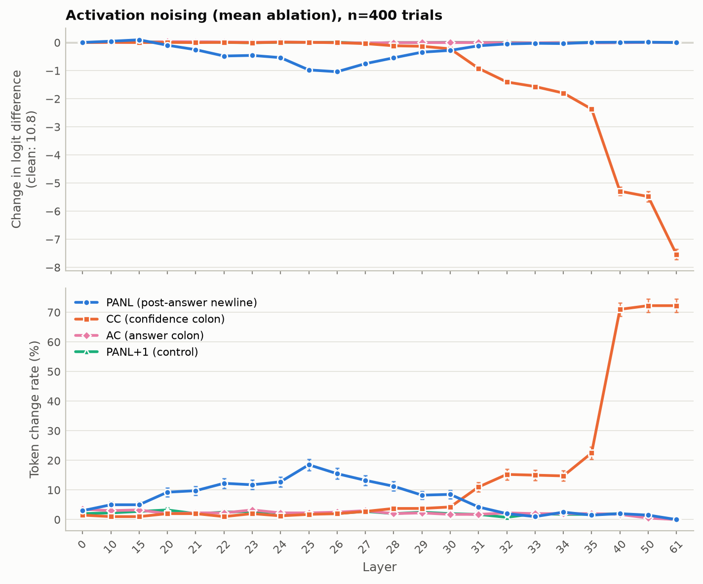

Mean-ablating one (position, layer) on 400 trials: PANL peaks at 18.5% token change at L25 with a logit-difference
drop of −1.04 at L26 (paper ≈ 14% and ≈ −0.9, same layers); CC is flat until L30, then 22% at L35 and 71% at L40
(paper 19% and 71%); PANL+1 and the answer colon never exceed 3.5% (paper 3–4%). The PANL effect comes mostly
from low-confidence trials (31.5% of them change at L25, against 5.4% of high-confidence trials).

### Activation swap (Figs. 5, 20)


PANL activations from a length-matched donor trial are transplanted into a recipient (400 high- and 400
low-confidence recipients). Cross-confidence swaps move confidence toward the donor, same-confidence swaps do not:

| at PANL, peak layer 25–26 | Paper | Here |
|---|---|---|
| low recipient ← high donor: confidence change | ≈ +0.21 | +0.21 |
| high recipient ← low donor: confidence change | ≈ −0.065 | −0.038 |
| same-confidence swaps: confidence change | ≈ ±0.02 | ≤ ±0.02 |
| token change, low←high vs low←low | ≈ 37% vs 13% | 47.5% vs 27.3% |
| token change, high←low vs high←high | ≈ 28% vs 16% | 21.5% vs 8.2% |

At CC the same directional transfer appears only from L31 (low←high +0.26 at L31; +0.79 / −0.79 by the last
layers; paper ≈ +0.68 / −0.65), and at PANL+1 nothing happens (|Δconfidence| ≤ 0.006; right-hand column above, same
y-scale). CC is in `figures/fig20_swap_CC.png`.

### Decoding and variance partitioning (Figs. 6, 14, 13d)


Linear probes on 3,000 trials (5-fold CV). With the paper's ridge setting (α = 1, which over-fits until the
signal is strong) verbal confidence becomes decodable at PANL from L25 and at CC from L27–28 — the same layers
as in the paper — and CC ends higher (peak R² 0.88 at CC against 0.56 at PANL; paper 0.84 and 0.48).
Correctness AUROC from PANL reaches 0.74 at L20 and 0.81–0.83 from L28 (paper 0.75 and 0.83–0.84); the third
question token stays at 0.50–0.56 (paper ≈ 0.57).

Answer log-probabilities explain little of the verbal confidence: R²_CV = 0.096 (mean), 0.098 (min), 0.086
(first), 0.053 (last), 0.044 (max), 0.039 (variance), 0.099 (all six) — paper 0.084, 0.101, 0.070, 0.039, 0.025,
0.051, 0.100. PANL activations add R²_unique = 0.39 at L40 beyond all six (paper 0.38), peaking at 0.46 at L50;
CC adds 0.78 (paper ≈ 0.76). These use the paper's ridge α = 1; with the penalty tuned on the training folds
(`scripts/probe_unique.py`, added with the two-turn extension) PANL adds 0.62 at L40.


### Answer colon (Sec. 2.7, Fig. 13)

The token that produces the answer does not carry the confidence signal: steering it changes confidence by at
most 0.08, with both vectors pushing the same way, mean-ablating it changes at most 3.5% of tokens (same as
PANL+1), and a ridge probe with its penalty tuned on the training folds reaches R² = 0.19 there against 0.78
at PANL and 0.75 at PANL+1 (paper ≈ 0.2, 0.75, 0.70;
`figures/fig13d_decoding_AC.png`). Restoring AC in the patching experiment is a no-op by construction (it
precedes the corrupted tokens) and reproduces the corrupted run exactly.

### Attention blocking (Figs. 7, 21)

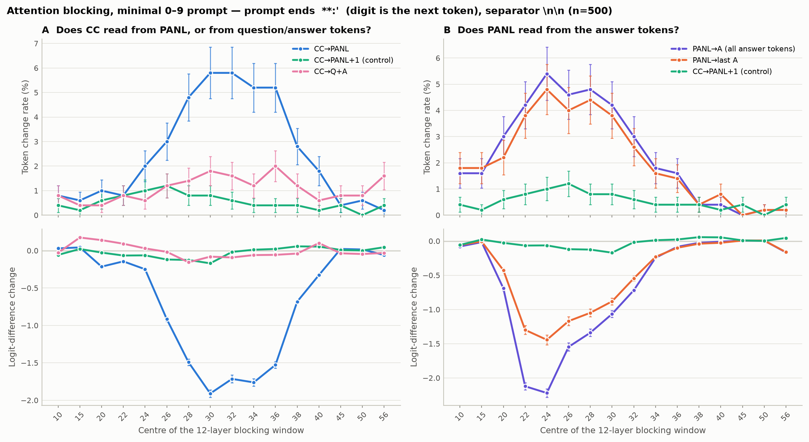

Attention edges are knocked out in 12 consecutive layers on a minimal 0–9 confidence prompt (500 trials).
Blocking PANL's attention to the answer tokens hurts most in windows centred on layers 22–24; blocking CC's
attention to PANL hurts most in windows centred on layers 30–34; blocking CC's attention to the question and
answer tokens does nothing beyond the PANL+1 control. That is the paper's ordering (22–28, then 30–36) and its
conclusion: answer tokens → PANL → CC, with no just-in-time computation at CC.

The size of the effect depends on how the prompt ends, which the paper's Fig. 16 leaves ambiguous, so all four
variants were run:

| Minimal prompt variant | Clean logit diff | CC→PANL: peak Δ logit diff / token change | PANL→A: peak Δ logit diff / token change | CC→PANL+1 control: peak token change (windows ≥ L20) | CC→Q+A, windows L20–45: peak token change / Δ logit diff |
|---|---|---|---|---|---|
| Paper (Fig. 7) | not given | ≈ −0.8 / 21% @ L30–36 | ≈ −0.5 / 20% @ L22–28 | ≈ 10% | ≈ 10–12% / ≈ −0.25 |
| ends `**:'`, separator `\n\n` (figure above) | 8.7 | −1.91 @ L30 / 6% @ L30 | −2.22 @ L24 / 5% @ L24 | 1% | 2% / −0.16 |
| ends `**:'`, separator `\n` | 8.4 | −1.92 @ L34 / 8% @ L30 | −1.84 @ L24 / 6% @ L24 | 2% | 1% / −0.06 |
| ends `**:`, separator `\n\n` | 4.4 | −0.48 @ L30 / 42% @ L30 | −0.61 @ L22 / 37% @ L22 | 9% | 9% / −0.10 |
| ends `**:`, separator `\n` | 4.6 | −0.73 @ L30 / 55% @ L32 | −0.48 @ L24 / 23% @ L22 | 10% | 12% / −0.12 |

The four rows agree on where the effects sit. With the trailing quote the digit is the model's actual next token
and 97% of clean answers are "9" with large margins, so few argmax digits flip although the logit shifts are
large. Without it the model's next token is usually a space and the digit logits at CC have small margins; the
numbers then come out near the paper's, closest for the single-newline form (CC→PANL −0.73 vs ≈ −0.8, PANL→A
−0.48 vs ≈ −0.5, control 10% vs ≈ 10%), which is probably what the paper used. In the two no-quote variants
the earliest windows are noisy: in the first two (layers 4–20) even the control edge changes 13–20% of digits,
and blocking CC's attention to the answer tokens changes 25–30% in the first window and 8–15% in the last two
(figures for all variants: `figures/fig07_attention_blocking_minimal_*.png`).

On the categorical prompt, with edges blocked in all layers (500 trials):

| Blocked edges | Paper (Fig. 21) | Here |
|---|---|---|
| CC → PANL+1 (control) | ≈ 10% | 0.8% |
| CC → PANL / answer / question / question+answer | ≈ 9–12% | 2.8% / 2.0% / 1.2% / 2.8% |
| all later tokens → PANL | ≈ 18% | 13.6% |
| all later tokens → last answer token | ≈ 51% | 61.4% |
| … but PANL keeps its edge to the last answer token | ≈ 24% | 24.4% |
| all later tokens → all answer tokens | ≈ 68% | 64.6% |
| … but PANL keeps its edges to the answer tokens | ≈ 51% | 30.8% |

CC alone does not need the question or answer tokens, the answer tokens are the source of the signal, and
letting only PANL read them restores most of the behaviour. The paper's ≈ 10% for the control and all CC-only
conditions is ≈ 1–3% here. Measuring against unedited rows from the same forward pass (deviation 5) accounts
for about one point of that; the rest is unexplained (see
[What the effect sizes depend on](#what-the-effect-sizes-depend-on)).

### Interventions stay in distribution (Table 1)

Cosine similarity and norm ratio between clean and perturbed activations at layer 25 stay inside the natural
trial-to-trial spread, as in the paper's Table 1. At PANL the numbers agree with the paper's to within 0.03
(steering at scale 5, high vector: cosine 0.991 / norm ratio 0.92, paper 0.992 / 0.91; patching: 0.998 / 0.97,
paper 0.999 / 0.94). At PANL+1 the perturbations are just as small (cosine at least 0.992, norm ratios
0.92–1.10), although the two steering vectors change the norm in the opposite direction to the paper's table.
At this control position the direction is mostly trial noise, and that sign differed between my own choices
of steering trials. As in the paper, PANL and PANL+1 are perturbed equally and only PANL changes the output.

### Robustness checks

The paper leaves several choices open that could matter for the size of the PANL effects, so they were varied.

| Patching run | Clean confidence / logit diff | PANL: peak logit-diff recovery | PANL: peak confidence recovery | PANL: lowest token change | CC: confidence recovery @ L30 / L35 / L40 | PANL+1: largest logit-diff recovery |
|---|---|---|---|---|---|---|
| Paper (Fig. 3) | ≈ 0.68 / 11.9 | ≈ 20% @ L25 | ≈ 40% @ L25 (confidence 0.38) | ≈ 78% | ≈ 0% / 22% / 95% | ≈ 0% |
| **Main run:** trials chosen by Phase-0 confidence, corrupting means taken over all calibration prompts at the same sequence position | 0.82 / 13.2 | 13.2% @ L25 | 24.4% @ L25 (confidence 0.24) | 82% | 0% / 38% / 100% | 0.1% |
| Phase-1 top-3 trials, same corruption | 0.92 / 14.8 | 12.8% @ L22 | 20.3% @ L25 (confidence 0.23) | 91% | 0% / 42% / 98% | 0.1% |
| Phase-0 trials, means over the calibration answers' tokens at the same answer position | 0.82 / 13.2 | 11.6% @ L22 | 16.4% @ L22 (confidence 0.18) | 89% | 0% / 35% / 99% | 0.2% |
| Phase-1 top-3 trials, means per answer position | 0.92 / 14.8 | 10.4% @ L22 | 9.2% @ L22 (confidence 0.13) | 96% | 0% / 39% / 98% | 0.1% |
| Phase-1 top-3 trials, one mean over all calibration answer tokens | 0.92 / 14.8 | 10.3% @ L22 | 10.0% @ L22 (confidence 0.14) | 96% | 0% / 36% / 98% | 0.1% |
| Phase-1 top-3 trials, means per answer position, separator `\n` | 0.92 / 14.7 | 10.7% @ L22 | 14.2% @ L26 (confidence 0.17) | 92% | 0% / 37% / 98% | 0.2% |

- **How the corrupting embedding is built.** The paper's eq. (1) averages over all 100 calibration trials at
  each answer position. If positions index the input sequence, an answer token is replaced by the mean
  embedding of whatever the 100 calibration prompts have at that sequence position (question, answer or
  template tokens, depending on their question lengths). If positions index the answer, it is replaced by the
  mean of the calibration answers' k-th tokens, and for later tokens that mean covers few answers (62, 33, 17
  and 5 for the second to fifth token). The main run uses the first reading; the second recovers less, and so
  does a single mean over all calibration answer tokens.
- **How patching trials are chosen.** The paper selects its 200 "high-confidence" patching trials by Phase-0
  confidence, and their clean Phase-1 confidence is only about 0.68 (the L61 point of the CC curve in its
  Fig. 3, which by construction equals the clean run). Trials selected the same way have a clean confidence of
  0.82 here and recover more than trials selected by Phase-1 confidence.
- **Separator after the answer.** With a single `\n` as the PANL token instead of `\n\n`, patching (table),
  noising and attention blocking give the same picture. Noising PANL peaks at 22.2% token change at
  L26 (main run 18.5% at L25), with PANL+1 at most 4.0% and the answer colon at most 4.8%.
  With all layers blocked, cutting every later token off from the last answer token changes 60% of
  tokens (main run 61%), 20% if PANL keeps its edge (24%), and blocking CC→question+answer
  changes 5.6% (2.8%).
- **Prompt format.** Feeding the same prompt with one or three newlines after the answer, without `<bos>`, or
  through the chat template (turn left open, or the final `**Confidence**:` pre-filled as the model turn)
  does not turn the Phase-1 confidence into the paper's Fig. 9 on 1,000 trials: "Almost certain" answers
  stay 94–97% correct in every variant (Fig. 9: 86%), and "No chance" stays at 4–8% of trials (Fig. 9: 1.5%).
  Pre-filled chat variants give logit differences of about 36 for high-confidence trials, against 11.9 in
  the paper and 15 with raw text, and without `<bos>` the model no longer outputs a class
  (`results/pilot_format/summary.json`).

Trial selection and the reading of eq. (1) together take the PANL confidence recovery from 9% to 24% (paper
≈ 40%).

### What the effect sizes depend on

The differences from the paper are in the size of some effects, not in where they occur. Checks on the saved
outputs (`sensitivity` in `results/summary.json`) show what those sizes are sensitive to.

**Patching: how hard the corruption hits, and how long the answer is.** After corruption "No chance" beats the
clean class by 15 logits on average, but that margin varies between trials, and the recovery from restoring
PANL at L25 varies with it and with the number of answer tokens (369 trials with a clean class in the top
three; the two runs with the main corruption pooled):

| Trials | n | Mean margin of "No chance" over the clean class | Logit-diff recovery | Confidence recovery | Confidence after patch | Clean class restored |
|---|---|---|---|---|---|---|
| Smallest quarter by margin | 93 | 11.4 | 22.5% | 40.3% | 0.41 | 28.0% |
| Second quarter | 92 | 13.0 | 14.0% | 26.3% | 0.29 | 13.0% |
| Third quarter | 92 | 15.7 | 12.7% | 16.2% | 0.19 | 6.5% |
| Largest quarter | 92 | 18.7 | 2.3% | 4.9% | 0.09 | 1.1% |
| One-token answers | 113 | 14.1 | 24.7% | 52.4% | 0.50 | 26.5% |
| Two-token answers | 129 | 14.4 | 10.9% | 15.1% | 0.18 | 10.1% |
| Three- and four-token answers | 99 | 15.2 | 4.4% | 4.1% | 0.09 | 2.0% |
| Five or more tokens | 28 | 16.6 | 2.1% | 0% | 0.05 | 0% |
| All | 369 | 14.7 | 12.8% | 22.5% | 0.24 | 12.2% |
| Paper (Fig. 3) | 200 | not reported | ≈ 20% | ≈ 40% | 0.38 | ≈ 22% |

The paper's numbers are those of my one-token answers, or of the quarter of trials on which the corruption is
mildest. They would follow if the paper's answers were shorter or its corruption milder than mine; it reports
neither the answer lengths nor this margin, so that cannot be checked.

**Steering at PANL: which trials define the direction.** The direction is the difference between the means of
25 + 25 trials, and at PANL it is not stable across choices of those trials. Between random draws the cosine
is 0.86–0.94 in layers 20–22, drops to 0.5–0.75 in layers 23–25 (−0.14 for one pair at L24) and returns to
0.92 or more at L26; at CC it is 0.86–0.99 (`results/vector_sensitivity.json`). The effect sizes move with
the direction (200 test trials; `figures/fig02b_steering_vector_trials.png`):

| Direction built from | High vector, scale 5 | Low vector, scale 5 | High vector, scale 2 | Low vector, scale 2 |
|---|---|---|---|---|
| Paper (Fig. 2) | ≈ +0.18 @ L25–26 | ≈ −0.22 @ L24 | ≈ +0.17 @ L25 | ≈ −0.09 @ L24–25 |
| Random ties, draw 0 (main run) | +0.31 @ L22 | −0.24 @ L23 | +0.30 @ L24 | −0.14 @ L24 |
| Random ties, draw 1 | +0.33 @ L24 | −0.27 @ L26 | +0.28 @ L25 | −0.14 @ L25 |
| Random ties, draw 2 | +0.31 @ L24 | −0.32 @ L24 | +0.28 @ L25 | −0.11 @ L27 |
| Most extreme trials first | +0.27 @ L24 | −0.46 @ L22 | +0.22 @ L22 | −0.10 @ L23 |

With ties broken at random the low vector has the paper's effect and peak layers; taking the most extreme
trials first doubles it and moves the peak to L22. A random-tie direction also reproduces the paper's Table 1
statistics for the steered activations more closely (cosine 0.991, norm ratio 0.92; paper 0.992, 0.91) than
the most-extreme one (0.994, 0.89). The high vector raises confidence by about 0.3 whichever trials are used,
against ≈ 0.18 in the paper. That effect comes from the low-confidence trials, which rise by 0.5–0.6 here.

**Token-change rates: how many trials sit near a class boundary.** Argmax flips come almost only from trials
whose two most likely classes are within one logit of each other. In same-confidence swaps at PANL (L25), 44%
of the low-confidence recipients in that range change class, against 4% of those more than three logits
clear (25% against 0% for high-confidence recipients). Here 49% of low-confidence and 26% of high-confidence
recipients are within one logit, so same-confidence swaps change many low recipients and few high ones. The
confidence shifts, which flips between neighbouring classes barely move, agree with the paper.

**Attention-blocking controls: only a few points are numerical.** Unedited rows differ from a separately
computed clean run in 1.4% of trials, and measured against that run the control and CC-only conditions read
1.2–4.0% instead of 0.8–2.8%. The paper ran its attention experiments with the eager attention implementation.
Here the eager and the default implementation give a different class on 3.0% of the same 500 prompts, and a
prompt run on its own instead of in a batch on 2–5% (`scripts/numtest_eager.py`). A reference run computed
differently from the blocked runs would therefore add a few points, not the paper's ≈ 10%. No trial more than
one logit from a class boundary flips in any of these conditions.

## Extension: two-turn chat format

The paper, and everything above, feeds one raw-text prompt in which the question, the model's earlier answer
and the confidence instructions follow each other. This section asks whether the mechanism is still there in
an ordinary chat exchange, where the answer is the model's own turn and the confidence request arrives in a new
user turn:

```
<bos><start_of_turn>user
Question: {question}
Answer with just the answer itself (a name, number or short phrase), nothing else.<end_of_turn>
<start_of_turn>model
{answer}<end_of_turn>
<start_of_turn>user
Classify your confidence into one of the following classes based on how
likely the answer above is to be correct (NO REASONING OR EXPLANATION):

- "No chance" (0.0–0.1)
  …
- "Almost certain" (0.9–1.0)

Each category reflects the probability that the answer is correct.

Reply with only the name of the class (only the name without the probability range).<end_of_turn>
<start_of_turn>model
```

The answer is the one the model generated in that turn (greedy). Nothing is pre-filled in the second model
turn: the class is read from the next-token logits at the end of the prompt, so it is the first token of the
reply. The request keeps the paper's wording except for its last sentence. Everything else is the pipeline
above run with `VC_FMT=tt` (same layers, metrics, trial-set rules and code); what the format forced me to
change is listed under [Two-turn setup](#two-turn-setup).

The positions, named by their place in the prompt:

| Name here | Tokens | Counterpart in the paper's prompt |
|---|---|---|
| end-of-turn token | the `<end_of_turn>` that closes the answer turn, the first token after the answer | PANL |
| boundary tokens | the five tokens between answer and request: `<end_of_turn>`, newline, `<start_of_turn>`, `user`, newline | PANL (one token there) |
| request tokens | the 217 tokens of the confidence request | the instruction text; its first token is the paper's control, PANL+1 |
| final tokens | `<end_of_turn>`, newline, `<start_of_turn>`, `model` after the request | none |
| last token | the newline that opens the model's reply and emits the class | CC |

### What replicates

The mechanism is there; the behaviour is different.

| Paper result | Single prompt (above) | Two-turn chat | Replicates? |
|---|---|---|---|
| Calibration (Fig. 9) | answer fed back: ECE 0.06, AUROC 0.81, 11.5% of trials in the bottom-3 classes | ECE 0.12, AUROC 0.74, 0.8% in the bottom-3 classes | Matches Fig. 9, not the fed-back single prompt: the model almost never doubts an answer in its own turn |
| Patching: the signal sits right after the answer in layers 20–28 and reaches the emitting token only from ≈ L30 (Fig. 3) | PANL @ L25: confidence 0.24 (clean 0.82, corrupted 0.05); CC from L34–35 | end-of-turn token @ L25: 0.77 (clean 0.92, corrupted 0.46); all five boundary tokens 0.86; last token from L30 | Yes, in the same layers |
| The token next to it is a control and carries nothing | PANL+1: nothing | first request token, `<start_of_turn>`, `user`: nothing; the newline right after the end-of-turn token: 0.73 | Yes for the request text. The signal is on two tokens, the end-of-turn token and the newline after it |
| Steering (Fig. 2), high / low vector at scale 5 | PANL +0.31 / −0.24; CC +0.43 / −0.44 | boundary tokens +0.31 / −0.04 @ L25 (end-of-turn token alone +0.09 / −0.02); last token +0.39 / −0.02 from L28 | Raising confidence: yes. Lowering: the logits move, the stated class does not |
| Swap (Fig. 5), low recipient ← high donor | +0.21 @ L25 at PANL; same-confidence swaps ≤ 0.02 | +0.35 @ L25 at the boundary tokens (+0.10 at the end-of-turn token); same-confidence ≤ 0.04 | Yes |
| Noising (Fig. 12) | 18.5% of tokens change @ L25 at PANL | 4.2% @ L25 at the end-of-turn token, 10.8% @ L26 at the boundary tokens | Same layers, fewer class changes |
| Attention blocking (Figs. 7, 21): the emitting token does not read the answer; the token after the answer does | CC → answer: 2.0%; all later tokens → answer: 64.6%, 30.8% if PANL keeps its edges | last token → answer: 0.0%; all later tokens → answer: 32.6%, 8.0% if the boundary tokens keep theirs | Yes |
| Decoding: confidence is decodable after the answer before it is at the emitting token (Fig. 6) | tuned ridge @ L25: PANL 0.61, CC 0.31 | end-of-turn token 0.32, newline after it 0.38, last token 0.21 | Yes with a tuned probe; with the paper's α = 1 the newline leads (L27 against L29) and the end-of-turn token does not (L32) |
| More than log-probabilities (Fig. 14) | R² beyond six log-prob summaries at PANL, L40: 0.39 with the paper's α = 1, 0.62 with a tuned ridge | end-of-turn token: 0.06 with α = 1, 0.41 @ L40 with a tuned ridge; newline after it: 0.14 and 0.40 @ L28 | Yes with a tuned probe; α = 1 over-fits here and shows little |

How the chat format differs from the single prompt:

- **The model is far more confident, and its logits are far more peaked.** 75% of trials are "Almost
  certain" and 23% "Highly likely". The leading class is ahead of the runner-up by a median of 9.5 logits
  (1.8 in the single prompt), so the same shift in the logits flips fewer stated classes. That is why
  lowering confidence by steering or swapping, and noising, show little in the paper's argmax-based
  metrics here, and why a logit-based readout is reported next to them.
- **PANL's role is shared by two tokens.** The end-of-turn token and the newline after it each restore
  59–66% of the lost confidence when patched and are steered and decoded alike; edited together with the
  other three boundary tokens they give the effects that compare with PANL.
- **The signal passes through the request text, which turns out to hold for the single prompt too.**
  Restoring all request tokens recovers the confidence in layers 24–34, after the boundary tokens (20–28)
  and before the last token (30 and later). The last token does not read the boundary tokens directly. A new
  single-prompt run shows the same relay there, as the paper's appendix had suggested: the instruction
  tokens between PANL and CC carry the signal
  in layers 27–32.

The full side-by-side table is in [`results/tt/comparison.md`](results/tt/comparison.md), raw numbers in
`results/tt/summary.json`.

### Two-turn behaviour

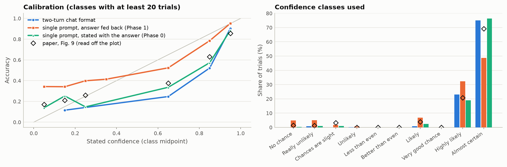

9,917 of the 9,960 questions give a valid trial, and in every one the first token of the reply is a confidence
class. The model gives the same answer as in the single-prompt run for 77% of the questions, and accuracy is
about the same (80.2% against 79.6%).

| | ECE | AUROC | "Almost certain" / "Highly likely" | bottom-3 classes | accuracy of "Almost certain" / "Highly likely" answers |
|---|---|---|---|---|---|
| Paper (Fig. 9) | 0.12 | 0.71 | 69% / 21% | 6.0% | ≈ 0.86 / 0.63 |
| Single prompt, confidence stated with the answer (Phase 0) | 0.11 | 0.72 | 76% / 19% | 2.3% | 0.88 / 0.57 |
| Single prompt, answer fed back (Phase 1) | 0.06 | 0.81 | 49% / 32% | 11.5% | 0.95 / 0.78 |
| Two-turn chat | 0.12 | 0.74 | 75% / 23% | 0.8% | 0.90 / 0.52 |

Asked about an answer in its own turn, the model behaves as it does when it states its confidence together
with the answer, and as in the paper's Fig. 9. It is less calibrated than when the same answer is fed back to
it as "an answer you previously provided". On the 7,617 trials with the same answer in both formats, mean
confidence is 0.93 in the chat against 0.85 for the fed-back answer, the class is the same in 64%, and the
correlation is 0.51 (0.62 with the Phase-0 confidence). Of the bottom-3 trials, 78 are "Really unlikely", 4
"Chances are slight" and 1 "No chance", and 12 of the 83 answers are correct. Mean answer log-prob correlates
0.24 with the stated confidence and predicts correctness with AUROC 0.84, better than the stated confidence.

### Two-turn patching: where the signal sits, layer by layer

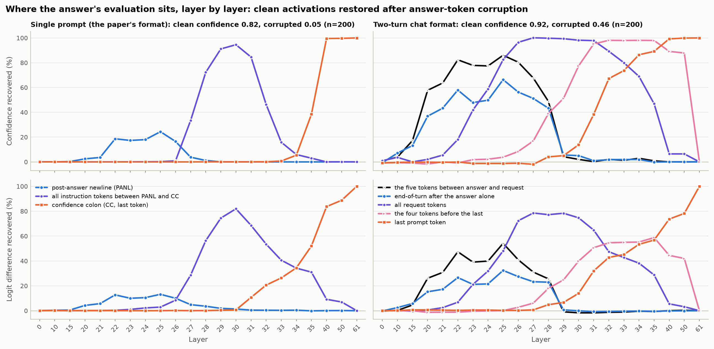

The answer-token embeddings of 200 high-confidence test trials are replaced by calibration means, as in the
main run. Confidence falls from 0.92 to 0.46 and the logit difference from 39.6 to 12.8. The corruption is
milder than in the single prompt, where every trial drops to "No chance": here 106 trials drop to "No chance"
or "Really unlikely" and 94 stay in a top class. Restoring clean activations at one layer:

| Restored | Layers with an effect | Peak confidence after patch | Peak logit-difference recovery |
|---|---|---|---|
| End-of-turn token | 20–28 | 0.77 @ L25 | 32% @ L25 |
| Newline after it | 20–26 | 0.73 @ L25 | 29% @ L25 |
| `<start_of_turn>`, `user`, newline before the request, first request token, `model`, one at a time | none | at most 0.48 | at most 4% |
| All five boundary tokens | 15–28 | 0.86 @ L25 | 54% @ L25 |
| All request tokens | 23–35 | 0.92 @ L27–30 | 79% @ L27 |
| The four final tokens | 28–50 | 0.92 @ L32–35 | 59% @ L35 |
| Last token | 30 and later | 0.87 @ L35, 0.92 @ L40 | 57% @ L35, 74% @ L40 |

Of the 106 trials that corruption sent to a bottom class, restoring the end-of-turn token at layer 25 brings
70% back into a top class and restoring all five boundary tokens 91%. After layer 28 the boundary tokens no
longer matter (confidence 0.48 at L29): by then the request tokens hold the signal, and they hand it to the
final tokens around layer 30. All single-token curves are in `figures/tt03_patching.png`.

The left half of the figure is a new run in the paper's format (`results/patch_p0_cabs_instr`, same trials and
corruption as the main patching run) in which all 244 instruction tokens between PANL and CC are restored
together. They recover nothing up to layer 26 and 72–95% of the confidence in layers 28–31, then fade as CC
takes over. The paper expected routing through these tokens (its appendix and limitations name it as the
likely reason why blocking CC→PANL alone does nothing on this prompt); this run shows it directly. So the
paper's two stages, PANL then CC, have a stage between them in its own format too, and the
chat format differs in degree: its post-answer stage is stronger and spread over two tokens, and its request
stage starts about four layers earlier and lasts longer.

### Two-turn steering

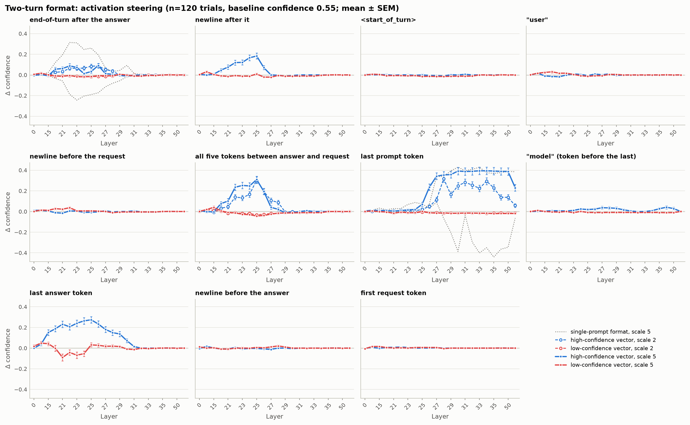

The direction is the mean of 25 "Almost certain" minus the mean of 25 "Really unlikely" trials, all answered
correctly, taken at each position and added with the paper's norm (scale × 3% of the residual norm) on 120
test trials, 60 from the top-3 and 60 from the bottom-3 classes (baseline confidence 0.55).

| Steered, scale 5 | Δ confidence, high / low vector | High vector on low-confidence trials | Shift of the high-minus-low logit, % of the gap between high- and low-confidence trials |
|---|---|---|---|
| End-of-turn token | +0.09 @ L26 / −0.02 | +0.18 @ L26 | +6% @ L26 / −6% @ L22 |
| Newline after it | +0.18 @ L25 / −0.02 | +0.37 @ L25 | +17% @ L25 / −5% @ L26 |
| All five boundary tokens | +0.31 @ L25 / −0.04 @ L25 | +0.62 @ L25 | +31% @ L25 / −13% @ L23 |
| Last token | +0.39 @ L33 / −0.02 | +0.79 @ L33 | +42% @ L29 / −35% @ L30 |
| Last answer token | +0.27 @ L25 / −0.09 @ L21 | +0.56 @ L25 | +30% @ L25 / −19% @ L21 |
| Controls: `<start_of_turn>`, `user`, newline before the request, first request token, newline before the answer | within ±0.02 | at most +0.03 | within ±3% |
| `model`, the token before the last | +0.04 @ L40 / −0.01 | +0.08 @ L40 | +10% @ L40 / −7% @ L28 |
| Single prompt: PANL | +0.31 @ L22 / −0.24 @ L23 | +0.60 @ L22 | +31% @ L22 / −42% @ L23 |
| Single prompt: CC | +0.43 @ L30 / −0.44 @ L35 | +0.82 @ L33 | +78% @ L35 / −73% @ L35 |

The high-confidence vector works where and when it does in the paper: at the boundary tokens in layers 20–26
and not after, at the last token from layer 26 on, and not at the request's first token or the other
controls. Steering all five boundary tokens raises low-confidence trials by 0.62, as much as steering PANL
does in the single prompt (0.60).

The low-confidence vector does not lower the stated class anywhere, not even at the last token. It does move
the logits in the right direction (−35% of the high–low gap at the last token, −13% at the boundary tokens),
but a high-confidence trial has its top three classes 36 logits above its bottom three here, against 16 in
the single prompt, so the class stays (`figures/tt02b_steering_logits.png` shows both formats on the logit
readout). On that readout the effect at the end-of-turn token alone is a fifth of PANL's or less, and at all
five boundary tokens it equals PANL's for the high vector and is a third of it for the low vector.

One caveat applies to steering only. These structural tokens vary little between trials: at layer 25 the
end-of-turn residuals of two trials have a cosine of 0.9989–0.9998 (5th–95th percentile), and the paper's
steering norm gives 0.998 at scale 2 and 0.989 at scale 5, outside that range. Patching and swaps use real
activations of another run or trial and show the same picture.

### Two-turn swap

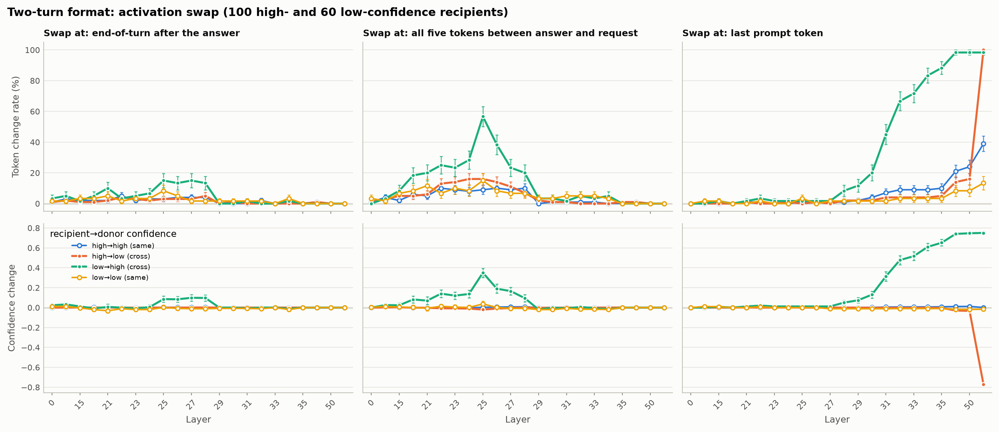

Activations of a length-matched donor trial are transplanted into 100 high- and 60 low-confidence recipients.

| Peak confidence change | Single prompt, PANL | End-of-turn token | All five boundary tokens |
|---|---|---|---|
| low recipient ← high donor | +0.21 @ L25 | +0.10 @ L27 | +0.35 @ L25 |
| high recipient ← low donor | −0.04 @ L26 | 0.00 | −0.02 @ L25 |
| same-confidence swaps | within ±0.02 | within ±0.03 | within ±0.04 |
| token change, low←high vs low←low | 47.5% vs 27.3% | 15% vs 8% @ L25 | 57% vs 15% @ L25 |

A high-confidence donor raises a low-confidence recipient when the boundary tokens are swapped in layers
20–28, and same-confidence swaps do nothing. As with steering, the reverse direction does not lower the
stated class. At the last token the transfer starts around layer 30 and reaches +0.74 by layer 40.

### Two-turn noising

Mean-ablating one position on 120 trials (`figures/tt04_noising.png`) changes few classes: 4.2% at the
end-of-turn token (L25), 6.7% at the newline after it, 10.8% at all five boundary tokens (L26), against
18.5% at PANL in the single prompt. The first request token, the newline before the request and the newline
before the answer stay at or below 2.5%. The last token is flat until layer 30, then 13% at L35 and 49% at
L40 (single prompt 22% and 71%). As in the single prompt the effect comes from low-confidence trials: ablating
the five boundary tokens changes 19% of them and removes 16% of their logit difference, where ablating PANL
changed 31% and removed 21%.

### Two-turn attention blocking

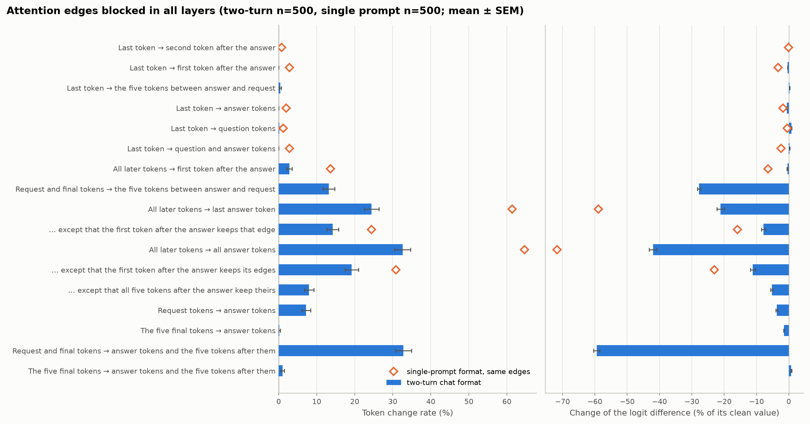

With edges blocked in all layers (500 trials; bars: chat format, diamonds: the same edges in the single
prompt):

- **The last token does not need the answer.** Blocking its attention to the answer, the question, or the
  boundary tokens changes at most 0.4% of tokens.
- **The boundary tokens are the main route.** If the request and final tokens cannot read the answer but the
  boundary tokens can, 8% of tokens change and 5% of the logit difference is lost. If nobody after the answer
  can read it, 33% change and 42% is lost.
- **The route is redundant.** Hiding the end-of-turn token alone from all later tokens changes 2.8% (PANL in
  the single prompt: 13.6%), because the newline after it holds the same information. Hiding all five
  boundary tokens from the request and final tokens costs 28% of the logit difference. The request tokens can also read the answer themselves:
  blocking that alone costs 4%, and it makes up for part of a blocked boundary route (hiding both the answer
  and the boundary tokens costs 59%).

In 12-layer windows on 200 trials (`figures/tt07_attention_windows.png`), blocking the boundary tokens'
attention to the answer hurts most in the window centred on layer 24, and blocking the later tokens'
attention to the boundary tokens in the windows centred on layers 22–26. The request and final tokens read
the answer directly somewhat later (windows centred on 26–32). Blocking the last token's attention to the
boundary tokens does nothing in any window, and neither does the control (hiding the first request token).
The paper's order, answer → post-answer token → emitting token, holds with the request tokens in between.

### Two-turn decoding

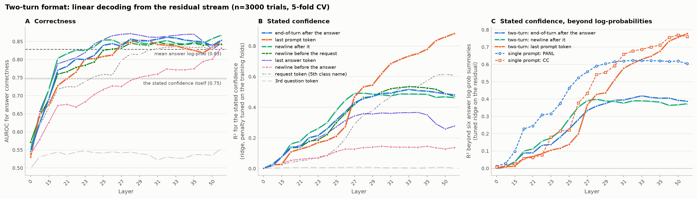

On 3,000 random trials (5-fold CV):

- **Correctness** is decodable from every boundary token: AUROC 0.76–0.80 at layer 20, 0.82–0.85 at layer
  25 and 0.84–0.87 at its peak (single prompt, PANL: 0.74, 0.80 and 0.83). The peaks are above mean answer
  log-prob (0.83) and far above the confidence the model states (0.75). The third question token stays at
  0.50–0.55.
- **Stated confidence**, with the ridge penalty tuned on the training folds, is decodable from the boundary
  tokens before it is from the last token: R² at layer 25 is 0.32 (end-of-turn token) and 0.38 (newline after
  it) against 0.21 at the last token, which overtakes them at layers 27–28 and ends at 0.88. The boundary
  tokens level off at about 0.5 (PANL in the single prompt: 0.78). The token before the answer stays at or
  below 0.15.
- **With the paper's ridge α = 1** the picture is less clear. That setting over-fits (negative R² until late
  layers), and more so here, where 98% of the trials are in two neighbouring classes. R² first exceeds 0.05
  at layer 27 at the newline after the end-of-turn token, at layer 29 at the last token and at layer 32 at
  the end-of-turn token (single prompt: PANL 25, CC 28).
- **Beyond log-probabilities.** The six answer log-prob summaries together explain 0.05 of the variance in
  stated confidence (0.10 in the single prompt). With the paper's α = 1 analysis the activations add little
  here: 0.06 at the end-of-turn token and 0.14 at the newline after it, against 0.39 at PANL in the single
  prompt. With the penalty tuned (`scripts/probe_unique.py`, panel C) the end-of-turn token adds 0.23 at
  layer 25 and 0.41 at layer 40, and the newline after it 0.40 at layer 28. The same analysis gives 0.46 and
  0.62 for PANL in the single prompt. The last token adds 0.78 by the last layer (CC in the single prompt:
  0.76).

### Two-turn setup

Choices the format required, beyond the [deviations](#deviations-and-judgement-calls) above:

1. **Wording of the question turn.** Chosen in a pilot on 300 questions with eight wordings
   (`scripts/tt_pilot.py --wording`). With five of them the model ends 80–100% of its answers with a full
   stop, often followed by a token of blank lines; the adopted wording gives a bare name or phrase (2% end
   with a full stop), so the last answer token is a content token as in the paper's format. The classes
   stated afterwards were distributed alike for all wordings (70–87% "Almost certain"; 2–5 of 300 trials in
   the bottom three).
2. **Form of the reply.** A second pilot (600 questions, with a first draft of the question turn) checked
   that the first token of the reply is a class in every trial. Keeping the paper's `**Answer**:` and
   `**Confidence**:` lines inside the turns gave a similar distribution (73% / 24% "Almost certain" / "Highly
   likely" against 80% / 19%), so the plain form was used.
3. **The answer turn.** The generated tokens are used as they are. Whitespace tokens around the answer (1.1%
   of trials) are dropped, as the chat template does when a turn becomes history. Excluded: 21 answers that do
   not tokenise back to the generated tokens and 22 longer than 12 tokens.
4. **Grading.** GPT-4o-mini as above. The 7,617 answers equal to the main run's answer after TriviaQA
   normalisation keep that verdict; 2,300 were graded anew.
5. **Low-confidence reservoir.** The collection set needs 25 correct low-confidence trials for the steering
   vector and 50 low-confidence trials for the calibration means, and the 3,000 random collection trials
   contain 23 low-confidence trials, 6 of them correct. So 24,000 questions of TriviaQA's train split were run through the same two
   turns, and their 171 bottom-3 trials (25 correct) were added to the collection set. They supply 21 of the
   25 low trials of the steering vector and 45 of the 50 low calibration trials, and nothing else: behaviour,
   probes and all test sets use validation questions only.
6. **Trial sets.** There are 60 low-confidence test trials, so steering and noising use 60 + 60 trials and
   swaps 100 high- and 60 low-confidence recipients; patching uses 200 high-confidence trials and attention
   blocking 500 random test trials (200 of them for the windows). Corruption for patching is the main run's
   (means over the 100 calibration prompts at the same sequence position).
7. **Grouped edits.** The five boundary tokens are also steered, ablated, swapped and patched together, each
   at its own position with its own vector, mean or donor activation. Patching also restores all request
   tokens or the four final tokens together.
8. **Attention blocking** is run on this prompt, in all layers and in 12-layer windows. There is no minimal
   0–9 variant.
9. **Logit readout.** Because the argmax class rarely moves here, steering and swaps are also reported as the
   shift of the mean logit of the three top classes minus that of the three bottom classes, as a share of the
   gap between unedited high- and low-confidence trials (41 logits here, 20 in the single prompt).
10. **Tuned variance partitioning.** `scripts/probe_unique.py` fits the six log-prob summaries by least
    squares and then a ridge regression of the residual on the activations, with the penalty chosen on the
    training fold; the paper's version (α = 1 for both) is the one in `scripts/probe.py`.

## Extension: reading the post-answer token with interpretability tools

The experiments above show where the confidence signal sits (the token after the answer) and when (layers
20–28). They do not show what is written there. Three tools released in 2026 for Gemma 3 27B IT read an
activation directly, and this section applies them to the post-answer token and to the steering direction.
None of them was trained or fitted here.

| Tool | What it does | Released artifact | Where it applies |
|---|---|---|---|
| Natural Language Autoencoder (NLA; Fraser-Taliente et al., [2026](https://transformer-circuits.pub/2026/nla/)) | A fine-tuned copy of the model, the verbalizer, writes a short text about one activation. A second model, the reconstructor, rebuilds the activation from that text alone, which scores the text | [`kitft/nla-gemma3-27b-L41-av`](https://huggingface.co/kitft/nla-gemma3-27b-L41-av) and `-ar` | residual stream after block 41 |
| Sparse autoencoder (SAE; Gemma Scope 2) | Writes an activation as a sparse sum of 1,048,576 learned features | [`google/gemma-scope-2-27b-it`](https://huggingface.co/google/gemma-scope-2-27b-it), `resid_post/layer_31_width_1m_l0_big` | after block 31 |
| Jacobian lens (Gurnee et al., [2026](https://transformer-circuits.pub/2026/workspace/index.html)) | Carries an activation from any layer into the last layer's coordinates with a fitted linear map and reads it with the model's own unembedding. The result is a ranking of the vocabulary: the words this activation disposes the model to say | [`neuronpedia/jacobian-lens`](https://huggingface.co/neuronpedia/jacobian-lens), `gemma-3-27b-it` | after every block |

Trials: the steering test set of each format, which is 100 high-confidence trials (top three classes) and 100
low-confidence trials (bottom three classes) in the single prompt, and 60 + 60 in the two-turn chat. The SAE
statistics and one lens readout use the 3,000-trial collection set, which has all classes. "PANL" is the
newline after the answer in the single prompt and the end-of-turn token in the chat format; "CC" is the last
prompt token.

### What the three tools say

**The token after the answer holds a verdict on the answer, "incorrect" or "correct", and the three tools
agree on that.** None of them finds a confidence class there in the layers where the token matters.

| Tool | On high-confidence trials | On low-confidence trials | Size of the difference (single prompt) |
|---|---|---|---|
| NLA, block 41 | the text expects `"Correct"`, `"Great! Your previous answer is correct."` to come next | the text expects `"The correct answer is..."`, `"That is incorrect"` | a word of error or correction in 13% of the explanations against 85%; 2% against 0% at a control token |
| SAE, block 31 | a praise feature (`commendable`, `congratulations`) and a "therefore" feature are stronger | features for `incorrect`, `unfortunately` and `actually` switch on | each of the three is active in 81–95% of low-confidence and 7–14% of high-confidence trials; the best single feature correlates −0.74 with the stated confidence |
| Jacobian lens, blocks 26–34 | `Therefore`, `Answer`, `Confirmation`, `correctAnswer` are among the top tokens | `Incorrect`, `Unfortunately`, `Seems` are among the top tokens | the rank of `Incorrect` separates the two groups with AUROC 0.92 at block 26 and 0.97 at block 32 |

- **The order of the paper's mechanism shows up in plain words.** In the lens, `Incorrect` separates low-
  from high-confidence trials at PANL from block 25 (AUROC 0.86) and at CC only from block 28 (0.86). The ten
  class tokens become readable at CC from block 31 and at PANL not before block 42. So the verdict is
  written after the answer first, reaches the last token three layers later, and is turned into a class
  there.
- **The verdict tracks the stated confidence, and the truth about as well as the stated confidence does.**
  On the 3,000 collection trials the lens score for `Incorrect` at PANL correlates −0.67 with the stated
  confidence at blocks 30–34 and tells wrong answers from right ones with AUROC 0.80, the same as the stated
  confidence itself (0.80).
- **The steering direction reads the same way but is mostly not made of such words.** Through the lens the
  high-confidence direction says `renowned`, `established`, then `excellent`, `congratulations`; the
  low-confidence direction says `dodgy`, `ridiculous`, then `incorrect`, `mistakenly`, then `actually`. Yet
  25 lens vectors rebuild only 1–6% of the direction, about what they rebuild of a random direction (4%),
  and the SAE rebuilds 58% of it at PANL. In steering controls, the part of the direction that lies along the token's
  average activation (up to two-thirds of its squared length) has no effect at all, and pushing against the
  lens direction of `Incorrect` at PANL raises low-confidence trials by +0.3 (an unrelated lens direction:
  +0.02 to +0.15; the whole steering direction: +0.33 to +0.57), while pushing along it lowers confidence by
  0.05 at most.
- **Two-turn chat:** the same verdict, in weaker words. `Incorrect` separates the groups at the end-of-turn
  token from block 26 and at the last token from block 27; an SAE feature for `However` is active in 61% of
  low- against 3% of high-confidence trials; the NLA mentions an error or correction in 10% against 48% of
  explanations.

Two example trials (single prompt), top lens token at PANL by block, and what the NLA expects next:

| | Block 26 | 28 | 30 | 31 | 34 | NLA at block 41: "strongly expecting ..." |
|---|---|---|---|---|---|---|
| *Where on the body would a huarache be worn?* → "Feet", correct, "Almost certain" | `Therefore` | `Explanation` | `<end_of_turn>` | `correctAnswer` | `correctAnswer` | `"Correct" or "Feedback:" or "Great! Your previous answer is correct."` |
| *Which actor ... holds the record ... with 142 [leading parts]?* → "Telly Savalas", wrong (John Wayne), "No chance" | `HOWEVER` | `HOWEVER` | `Incorrect` | `Incorrect` | `Incorrect` | `"Correct" or "Review" or "The correct answer is..."` |

### Jacobian lens

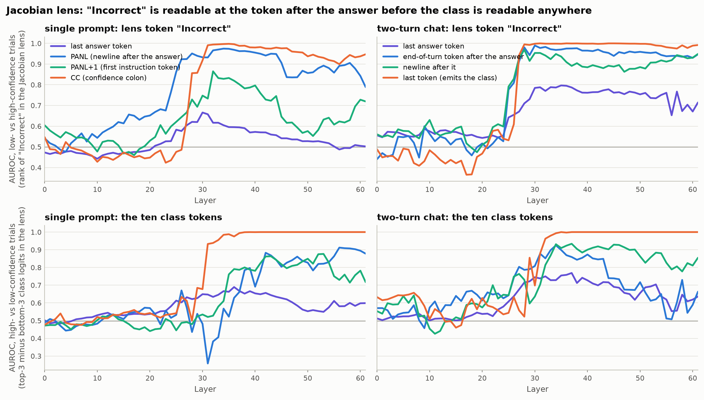

The lens readout at layer l is `unembed(h · J_lᵀ)`, with the released maps `J_l` (fitted on 828 wikitext
prompts) and the model's own final norm and unembedding. For each trial, layer and position I take the rank
of the token ` Incorrect` in that readout and ask how well the rank tells low- from high-confidence trials
(top row), and do the same for the ten class tokens (bottom row; score = mean of the top three class logits
minus mean of the bottom three).

| Readout, AUROC between the two groups | PANL | PANL+1 | Last answer token | CC |
|---|---|---|---|---|
| `Incorrect`, single prompt: first block above 0.8 / above 0.9 | 25 / 26 | 32 / never | never (peak 0.67) | 28 / 30 |
| Class tokens, single prompt: first block above 0.8 / above 0.9 | 42 / 56 | 38 / never | never | 31 / 31 |
| `Incorrect`, two-turn chat: first block above 0.8 / above 0.9 | 26 / 27 | 26 / 27 | never (peak 0.80) | 27 / 27 |
| Class tokens, two-turn chat: first block above 0.8 / above 0.9 | 27 / 34 | 32 / 34 | never | 29 / 32 |

- On low-confidence trials of the single prompt, ` Incorrect` is among the top lens tokens at PANL: median
  rank 57 at block 26, 4 at block 28, 0 (the top token) at block 30 and 1 at block 32, out of 262,144. On
  high-confidence trials its median rank is 353, 91, 24 and 34.
- The plain logit lens (no map) gives the same picture one step weaker: at PANL it passes 0.8 at block 25
  too, in the chat format at block 28 instead of 26.
- In the chat format the token ` Incorrect` separates the groups as well, but it is far from the top of the
  readout (median rank in the thousands); the end-of-turn token mostly reads as `<end_of_turn>`.
- The tokens that differ most between the two groups at PANL change with depth (single prompt):

| Block | Stronger on high-confidence trials | Stronger on low-confidence trials |
|---|---|---|
| 24 | `foundational` `established` `landmark` `important` | `bizarre` `stupidity` `dodgy` `rumoured` `botched` |
| 26 | `<eos>` `together` `iconic` `international` | `misguided` `incorrect` `mistakenly` `supposedly` and "wrong" in Hindi and Turkish |
| 28 | `confirmation` `confirms` `answer` `👍` `✅` | `misguided` `erroneously` `disastrous` and "wrong" in Turkish, Portuguese, German, Korean |
| 31–35 | `Congratulations` `👍` `Congrats` `<end_of_turn>` | `misguided` `inaccurate` `erroneous` `mistakenly` `misleading` |
| 41–50 | `excellent` `perfect` | `actually` `Actually` `unfortunately` |

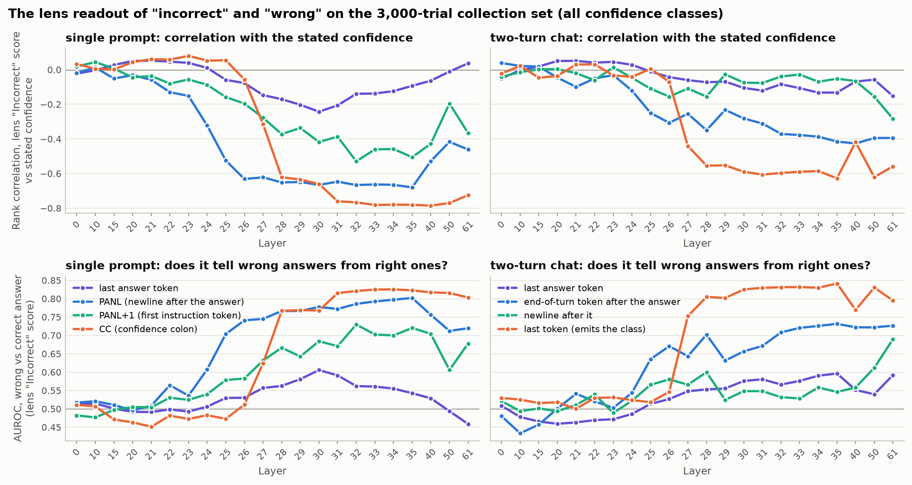

The same readout on the 3,000 collection trials, which include the middle classes (score = minus the mean
log rank of eight spellings of "incorrect" and "wrong"). At PANL its rank correlation with the stated
confidence is −0.32 at block 24, −0.52 at block 25, −0.63 at block 26 and −0.67 at blocks 30–34. At CC it is
−0.06 at block 26, −0.62 at block 28 and −0.78 at block 34. The score tells wrong answers from right ones
with AUROC 0.74 at PANL block 26, 0.80 at block 34, and 0.82 at CC block 34; the stated confidence reaches
0.80 on these trials.

### Sparse autoencoder

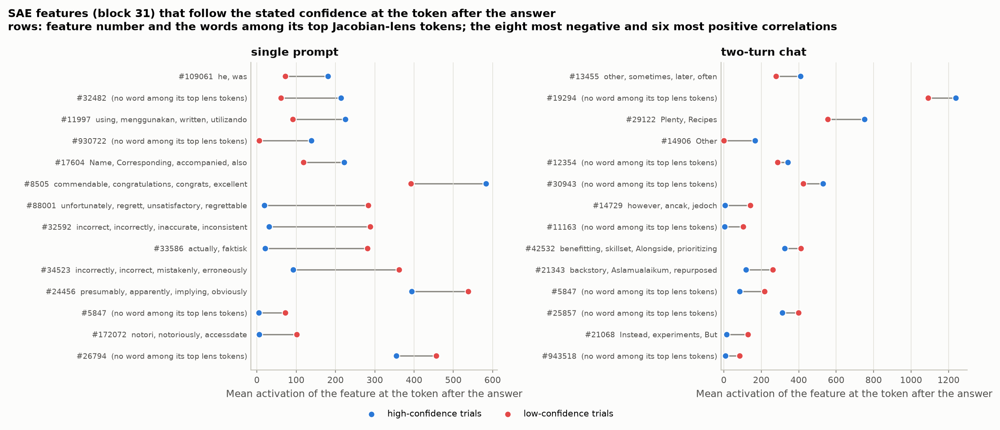

The SAE is applied to the stored block-31 activations of the collection set (JumpReLU, encoder input is the
raw residual). At PANL 1,014 features are active in at least 1% of trials; 83 of them correlate with the
stated confidence at |r| > 0.3 and 13 at |r| > 0.5. Those with a readable meaning:

| Feature | r with confidence | Active in high / low trials | Its top Jacobian-lens tokens | Strongest corpus example (the feature fires on the token in «») |
|---|---|---|---|---|
| 88001 | −0.74 | 7% / 91% | `unfortunately` `regrettable` `unsatisfactory` | "Right now, you need to hit a button to begin recording and capturing audio«.» I would like to add ..." |
| 32592 | −0.74 | 14% / 95% | `incorrect` `inaccurate` `inconsistent` | "'Nearby future«"» isn't standard English." |
| 33586 | −0.69 | 7% / 81% | `actually` (in six languages) | "This assumes all factors are equally important«,» which is almost certainly not true." |
| 34523 | −0.63 | 37% / 98% | `incorrectly` `mistakenly` `erroneously` | "'Can waiting«"» is grammatically incorrect." |
| 24456 | −0.55 | 100% / 100% (mean 394 / 538) | `presumably` `apparently` `evidently` | "They call it the lungs of the planet«.» Right now, it felt like ..." |
| 8505 | +0.51 | 100% / 98% (mean 583 / 392) | `commendable` `congratulations` `👏` | "This is a solid paragraph (p2) building a counter-argument«!»" |
| 38463 | +0.49 | 78% / 12% | `Therefore` `Thus` | "x = 1850 / 20, x = 92.5«\n\n»**Answer:**" |

- The low-confidence features fire on text that is about to be corrected or qualified. In the confidence
  prompt, 88001 and 33586 are active at PANL and at none of the other positions checked (answer colon, last
  answer token, PANL+1, a class name in the list, CC); 32592 and 34523 also fire at the answer colon.
- The other features with a positive correlation (109061, 32482, 11997, 930722, 17604) have no readable
  lens tokens and mixed corpus examples.
- The features that are most active at PANL on every trial read as a quiz being marked: `correct` /
  `incorrect` (4672, whose strongest corpus example is "You« are» absolutely right"), `quiz`, `Explanation`,
  and the praise feature.
- One feature predicts the stated confidence with cross-validated R² 0.53, five features 0.65, a hundred
  0.72. At CC the numbers are 0.59, 0.77 and 0.81, and the top features there are about the outcome:
  `successful` `happy` `positive` (1387) against `failed` `lack` (34157) and `only` `nothing` (92090).
- How much the SAE sees. It rebuilds every activation with cosine 0.995–0.997, but its error is 8–10% of
  the activation norm, while trials differ from each other at PANL by only 6% of the norm (2% at CC). It
  keeps 31% of the between-trial variance at PANL and none of it at CC (73% at the last answer token). The
  features above are what it does capture.
- Two-turn chat: confidence varies much less there, and features predict it less well (R² 0.14 with one
  feature, 0.32 with a hundred at the end-of-turn token). The clearest feature is `However` (14729), active
  in 3% of high- and 61% of low-confidence trials. At the last token the same outcome features lead as in
  the single prompt (1387: r = +0.71; 34157: r = −0.58).

### Natural Language Autoencoder

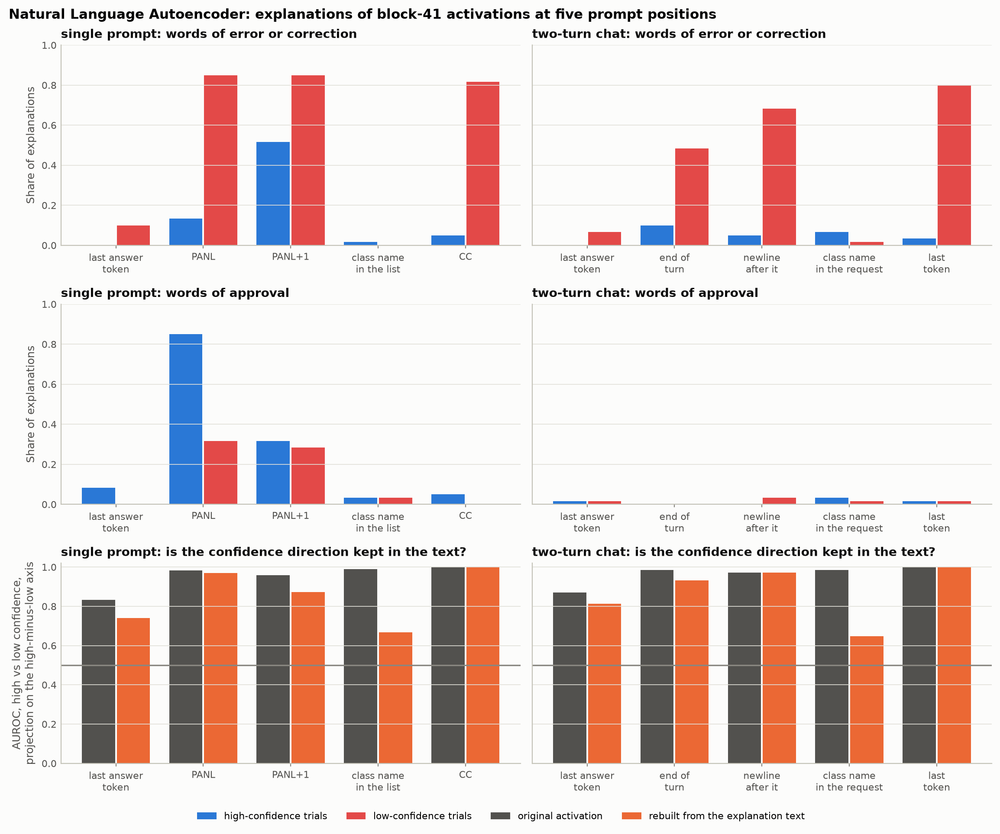

The verbalizer gets one block-41 activation, rescaled to norm 60,000 and placed at one token of its fixed
prompt, and writes about 150 tokens (greedy). Its explanations have three parts: the kind of text, a phrase
it believes it saw, and what it expects after the final token. The pipeline reproduces the example published
with the models: same explanations, and reconstruction scores of 0.76, 0.82 and 0.76 on three reference
tokens against the published 0.78, 0.81 and 0.76.

Typical explanations of PANL (single prompt):

> *High-confidence trial.* AI/educational platform context: a conversational bot explaining answers to a
> test or assessment question ... Final token ... ends a simple answer display, strongly expecting a new
> field or prompt, likely "Correct" or "Feedback:" or "Great! Your previous answer is correct." ... or "That
> is correct."

> *Low-confidence trial.* AI/educational platform response pattern: a conversational bot explaining a
> factual answer, establishing a feedback or assessment task ... immediately expecting a new field or
> feedback label, likely "Correct" or "Review your answer" or "Please evaluate..." to indicate the
> incorrect/correct assessment of the answer. or "That is incorrect" or "Next question" or "Feedback:".

| Position, block 41 (60 + 60 trials) | Error or correction words, high / low | Approval words, high / low | Groups told apart from the text alone (AUROC) | Reconstruction cosine |
|---|---|---|---|---|
| Last answer token | 0% / 10% | 8% / 0% | 0.83 | 0.992 |
| PANL | 13% / 85% | 85% / 32% | 0.97 | 0.985 |
| PANL+1 | 52% / 85% | 32% / 28% | 0.81 | 0.992 |
| A class name in the instruction list (control) | 2% / 0% | 3% / 3% | 0.82 | 0.987 |
| CC | 5% / 82% | 5% / 0% | 1.00 | 0.980 |
| End-of-turn token, two-turn chat | 10% / 48% | 0% / 0% | 0.96 | 0.989 |
| Newline after it, two-turn chat | 5% / 68% | 0% / 3% | 0.97 | 0.990 |
| Last token, two-turn chat | 3% / 80% | 2% / 2% | 1.00 | 0.983 |

Error words: incorrect, wrong, mistake, error, inaccurate, correction, corrected, "the correct answer
is/was", "not correct", misconception; the neutral pair "correct or incorrect" is removed first. Approval
words: "is correct", "you are right", great, well done, excellent, congratulations, perfect. The AUROC column
needs no word list: a classifier on word and word-pair counts, cross-validated.

- At PANL the difference is in the verdict words. At the last answer token the explanation is about the
  answer itself, and there it is often right about the content ("a discussion of sandals ... 'Answer:
  Feet'" for the huarache question). At CC it names the class to come, in its own words ("Absolutely
  Certain", "Very Sure" against "No Chance", "Ridiculous", "Quite Wrong").
- The control token has no verdict words, but its explanations still differ between the groups (0.82) in
  how they describe the class list. Confidence can be decoded from most tokens after the answer, so no
  later token is a clean control.
- Sampling at temperature 1, the setting the NLA was trained with, gives the same rates at PANL (13% / 88%
  over two samples per trial).
- The text keeps the confidence direction. Projected on the high-minus-low axis of the original
  activations (computed without the trial itself), the vectors rebuilt from the text separate the two
  groups with AUROC 0.97 at PANL, against 0.98 for the originals, and the two projections correlate 0.92
  across trials.
- The text keeps little else that is specific to the trial at PANL. A reconstruction is as close to other
  trials' PANL activations (cosine 0.984) as to its own (0.985), and the answers the NLA quotes are invented
  ("dog", "Einstein", "The Prophet"). The paper on NLAs reports the same pattern: themes are reliable,
  specifics are confabulated.
- Steering changes the explanation in the expected direction (40 + 40 trials). After the low-confidence
  direction is added at PANL in block 24 (scale 5), 90% of the block-41 explanations of high-confidence
  trials contain an error word, up from 15%. After the high-confidence direction, 10% of the low-confidence trials do, down from
  80%. A random direction of the same size leaves the high-confidence trials alone (10%) and moves the
  low-confidence trials part of the way (47%).
- Away from its training layer the NLA says less: applied to PANL at block 31 it still separates the groups
  (error words 35% / 95%), at block 25 it does not (0% / 10%).
- Two-turn chat: explanations of steered activations do not follow the direction (error words rise under
  both directions), so only the unsteered result is reported for that format.

### The steering direction

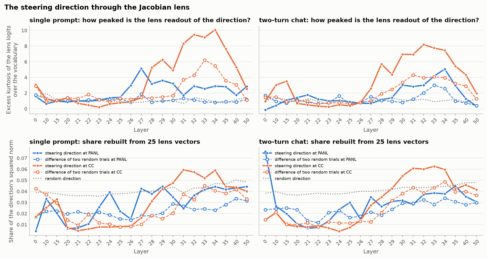

The steering direction at a position and layer is the difference between the mean activation of 25 "Almost
certain" trials and 25 "No chance" trials (as in the paper). Four observations about what it is made of.

**1. Through the lens it reads as a judgement that sharpens with depth** (single prompt; the low-confidence
direction is the same vector with the opposite sign):

| Position, block | Words added by the high-confidence direction | Words added by the low-confidence direction |
|---|---|---|
| PANL, 22 | `Wikipedia` `Wikidata` `UNESCO` `historical` `Encyclopædia` | `dodgy` `ridiculous` `awful` `wretched` `stupid` |
| PANL, 24 | `iconic` `foundational` `renowned` `established` | `stupidity` `ridiculous` `ludicrous` `pointless` `useless` |
| PANL, 28 | `<eos>` `ensures` `excellent` `nicely` `👍` | `misguided` `erroneous` `mistakenly` `incorrect`, "wrong" in five languages |
| PANL, 35 | `congratulations` `excellent` `continue` `👍` | `incorrect` `misguided` `inaccurate` `misleading` |
| PANL, 40 | `👍` `satisfied` `excellent` `perfect` `OK` | `Actually` `actually` `incorrect` |
| CC, 28–35 | `successful` `perfect` `excellent` `confidently`, in many languages | `failed` `failure` `disappointing` `poorly` `incorrect` |
| CC, 50 | "highly" in Russian, Thai and Chinese, "certainty" in Persian | `no` `unlikely` `No` `negative` `wrong` `zero` |

  At blocks 22–24 the lens readout of the direction is hardly more peaked than that of a random direction
  (excess kurtosis 1.0–1.4 against 0.7–0.9), so the first two rows are suggestive only. Later it is clearly
  peaked: 5.1 at PANL block 27 and 8–10 at CC blocks 31–34, against about 1 for random directions.

**2. It is not a sum of a few lens vectors.** A sparse non-negative combination of 25 lens vectors, the
lens paper's measure of how "sayable" a vector is, rebuilds 1–4% of the PANL direction (blocks 20–40) and
3–6% of the CC direction (blocks 28–40), about what it rebuilds of a random direction (4%). Its cosine with
the lens direction of `Incorrect` is −0.06 to −0.10.

**3. A large part of it points along the average activation of the token**, and the sign of that part flips
from layer to layer: the cosine between the PANL direction and the mean PANL activation is +0.83 at block
20, −0.58 at block 25, −0.75 at block 26 and +0.66 at block 31. That part carries none of the words above:
with it removed, 13.5 of the top 15 lens tokens of the direction stay the same on average. It also carries
none of the effect (next subsection).

**4. SAE features rebuild 58% of the PANL direction at block 31 and little of the CC direction.**

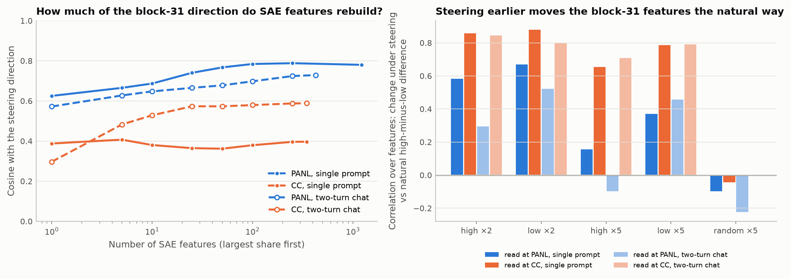

  The feature-by-feature difference of means, passed through the decoder, has cosine 0.78 with the PANL
  direction (0.74 with the 25 largest features alone) and 0.40 with the CC direction. The largest shares at
  PANL belong to features that fire where a reply or a paragraph is complete (22543, 29300, 10715; stronger
  on high-confidence trials), then `incorrect` (32592) and `correct`/`incorrect` (4672), both stronger on
  low-confidence trials. Steering at PANL in block 24 moves the block-31 features at CC the way they differ
  naturally between high- and low-confidence trials (correlation over features 0.86–0.88 at scale 2,
  0.65–0.79 at scale 5; −0.04 for a random direction).

### Steering with parts of the direction

Four controls on the 200 steering test trials of the single prompt, run with `scripts/interv.py` and the
scale of the main run (scale s adds s × 3% of the mean residual norm). An edit can only raise a
low-confidence trial or lower a high-confidence one, so effects are given for those: low-confidence trials
(stated confidence 0.13 before the edit) pushed up, and high-confidence trials (0.91) pushed down.

**1. The part along the average activation does nothing; the rest does everything.**

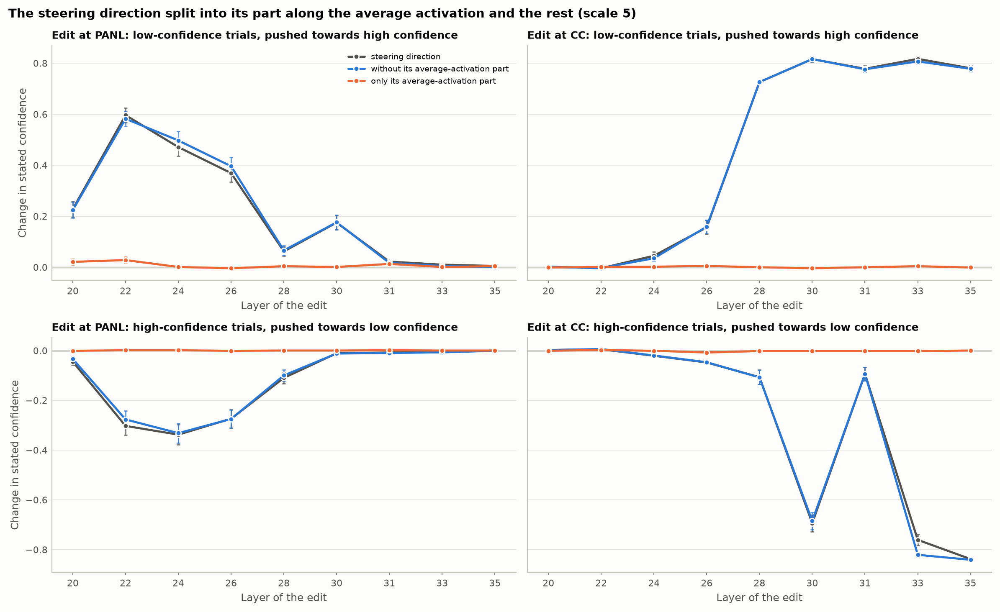

| Edit at scale 5: low-confidence trials up / high-confidence trials down | Steering direction | Without its average-activation part | Only its average-activation part |
|---|---|---|---|
| PANL, block 22 | +0.60 / −0.30 | +0.58 / −0.28 | +0.03 / 0.00 |
| PANL, block 26 | +0.37 / −0.27 | +0.40 / −0.28 | 0.00 / 0.00 |
| CC, block 30 | +0.82 / −0.69 | +0.82 / −0.69 | 0.00 / 0.00 |

  The inert part is 67% of the squared length of the PANL direction at block 22 and 57% at block 26 (62% of
  the CC direction at block 26, about 1% at blocks 28–31). The paper's scale is a share of the residual norm,
  so at those layers it overstates the size of the push that matters.

**2. The lens direction of `Incorrect` acts at PANL, in one direction only.**

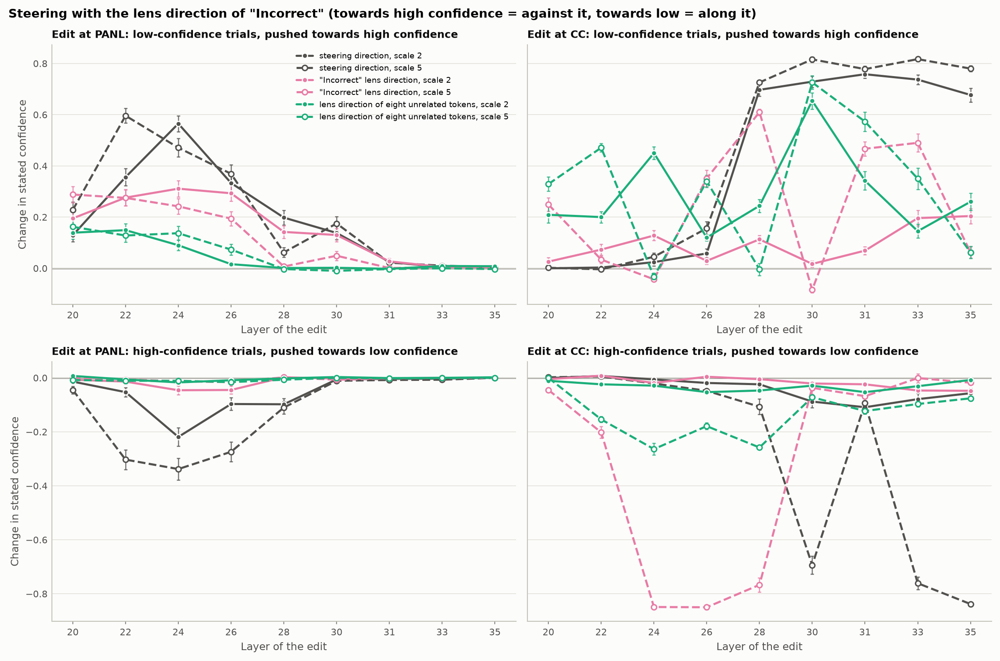

  The direction is the mean of the unit lens vectors of eight spellings of "incorrect" and "wrong"; the
  control is the same for eight unrelated tokens (Tuesday, blue, river, seven, window, music, garden, paper).
  Pushing against `Incorrect` at PANL (scale 2) raises the stated confidence of low-confidence trials by
  +0.28, +0.31 and +0.29 at blocks 22, 24 and 26. The same push against the unrelated tokens gives +0.15,
  +0.09 and +0.02, and the steering direction gives +0.36, +0.57 and +0.33. By block 31 the effect is gone
  (+0.03), as it is for the steering direction. Pushing along `Incorrect` lowers high-confidence trials by
  0.05 at most (steering direction: 0.22 at block 24). So at block 26 a push against the word lifts a doubted
  answer almost as far as the whole steering direction does, and at block 24 half as far; a push towards the
  word does not make the model doubt an answer.

  At CC, lens directions of this size disturb the output whatever the token: the unrelated tokens raise
  low-confidence trials by up to +0.73. One effect stands out against that. Adding `Incorrect` at CC in
  blocks 24, 26 and 28 at scale 5 lowers high-confidence trials by 0.85, 0.85 and 0.77 (unrelated tokens:
  0.26, 0.18, 0.26; the steering direction, which does not act at CC before block 28: 0.02, 0.05, 0.11).

**3. 25 lens vectors carry part of the raising effect and none of the lowering.**

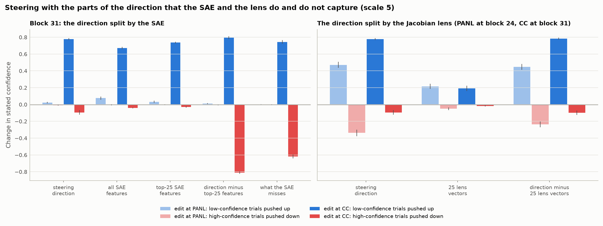

  The 25 lens vectors that best rebuild the PANL direction at block 24 are 4% of its squared length. Alone
  they raise low-confidence trials by +0.22 (whole direction: +0.47) and lower high-confidence trials by 0.05
  (whole direction: 0.34). The direction without them gives +0.45 and −0.24. At CC block 31 they give +0.19
  of +0.78.

**4. At block 31, SAE features are enough to raise confidence at CC and do not lower it.** The 25 features
with the largest share of the CC direction raise low-confidence trials by +0.74 (whole direction: +0.78). So
does the part of the direction that the SAE does not capture at all (+0.74). For lowering high-confidence
trials the feature part does nothing (−0.03) and the uncaptured part does it (−0.62). The whole direction
lowers them by only 0.09 at this block, against 0.69 at block 30 and 0.76 at block 33, so the two parts
work against each other here; I have no explanation for that. PANL cannot be steered at block 31 any more
(at most +0.08 for any part).

### Limits

- **Small, extreme trial sets.** The lens and NLA comparisons use 100 + 100 trials (60 + 60 in the chat
  format) from the top and bottom three classes. The collection-set results (3,000 trials, all classes) are
  the check on that: the lens score correlates −0.67 with the stated confidence there.
- **The NLA reads one layer and invents details.** It was trained at block 41, after the layers where
  patching and steering act on PANL (20–28); what it shows is the verdict as it still stands at block 41.
  Its reconstructions explain 49% of the variance at PANL by the published normalisation, against 76% on its
  training data, and quoted answers and phrases are not to be trusted.
- **The SAE misses most of what varies between trials** at these positions (see above). It sits at block 31,
  which is also after the layers where PANL is used; only the lens reads PANL inside those layers.
- **The lens was fitted on 828 wikitext prompts** and has one vector per vocabulary token, so concepts that
  need several tokens are out of its reach.
- **Word lists are mine.** The classifier AUROC and the reconstruction check do not depend on them.
- **Steering controls were run for the single prompt only.**

### Setup for this section

| Step | Script | Notes |
|---|---|---|
| Download | `scripts/interp_download.py` | 195 GB of traffic, 133 GB kept: verbalizer 51 GB (cast from float32 to bfloat16 shard by shard), reconstructor 36 GB, SAE parameters 43 GB, lens 3.3 GB. The SAE's 22 GB file of corpus examples is not downloaded; the rows needed are read over HTTP |
| Activations | `scripts/interp_capture.py` | every block at five positions for the steering test set; blocks 31 and 41 after steering (high and low direction at scales 2 and 5, and a random direction); all tokens of 24 trials |
| Jacobian lens | `scripts/interp_jlens.py` | readouts, the steering direction, sparse decomposition (non-negative orthogonal matching pursuit, k = 25, as in TransformerLens), inputs of the steering controls |
| SAE | `scripts/interp_sae.py` | feature statistics on the collection set, decomposition of the direction, feature descriptions |
| NLA | `scripts/interp_nla.py` | verbalizer with `generate(inputs_embeds=...)` in place of the reference SGLang server, then the reconstructor |
| Steering controls | `scripts/interp_controls.sh` | `scripts/interv.py --vec-file` with the split directions |
| Figures and numbers | `scripts/interp_analyze.py` | `figures/in*.png`, `results/interp/summary.json`, `results/interp/tables.md` (full token and feature tables) |

Conventions checked against the releases: "block l" is the output of decoder block l in all three (the
NLA's layer 41 is `hidden_states[42]`); my block-41 activation norms on the NLA's reference prompt are
within 0.3% of the published ones; the lens readout of the last block reproduces the model's own class
logits exactly; the SAE has a mean of 176 active features at PANL against its nominal 150.

## Differences from the paper

Where my numbers differ from the paper's by more than noise:

1. **Phase-1 confidence.** The paper's Fig. 9 is matched by my Phase-0 confidence. The paper gives no separate
   Phase-1 statistics, but its steering baseline (0.55) is what the class mix of Fig. 9 produces, whereas my
   Phase-1 classes give 0.52: among my low-confidence Phase-1 trials "No chance" and "Really unlikely" dominate
   (4.8% and 4.9% of all trials), in Fig. 9 "Chances are slight" does (3.3%). If Fig. 9 describes the paper's
   Phase 1 as well, its model doubts a fed-back answer less often than mine does. No prompt format I tried
   reproduces that (see Robustness checks). Mean answer log-prob also predicts correctness better here (AUROC
   0.81, paper 0.75).
2. **Patching at PANL is smaller.** Logit-difference recovery is 13% at L25 (paper ≈ 20%) and the confidence
   after the patch 0.24 (paper 0.38), because corruption pushes my runs to "No chance" by a 14-logit margin
   that a single-position patch reduces by two thirds but overturns in a minority of trials. Recovery falls
   steeply as that margin and the answer length grow; one-token answers reach the paper's numbers (see What
   the effect sizes depend on).
3. **Steering with the high-confidence vector at PANL is stronger** (+0.31 vs ≈ +0.18 at scale 5), because
   low-confidence trials rise further here. The low vector matches the paper when the ties among the
   steering-vector trials are broken at random (−0.24 vs ≈ −0.22) and is twice as strong when the most
   extreme trials are used.
4. **Same-confidence swap controls** differ in level: 27% of tokens change for low←low swaps (paper ≈ 13%) and
   8% for high←high (paper ≈ 16%). The cross-minus-same differences are similar (20 and 13 points here, ≈ 24
   and 12 in the paper), and the confidence shifts match. Token change follows the share of recipients within
   one logit of a class boundary (49% of low and 26% of high recipients here).
5. **Control levels in attention blocking.** The paper's control and CC-only conditions sit at ≈ 10% token
   change; mine are at ≈ 1–3% on the categorical prompt. Numerical differences between reference and blocked
   runs (same-pass reference, attention implementation, batch shape) account for a few points at most. On the
   minimal prompt the size of every effect depends on the prompt ending.
6. **Late-layer decodability at control tokens** is higher than in the paper (ridge α = 1: PANL+1 0.43 and FCC
   0.67 at L40, paper ≈ 0.3 and ≈ 0.4), and the unique variance at PANL peaks at L50 (0.46) rather than L40.

Not attempted: the numeric 0–100 prompt, BigMath, MMLU, Qwen 2.5 7B and Magistral Small (Sec. 2.9).

## Methods and deviations

All experiments use `google/gemma-3-27b-it` (62 layers, d = 5376) in bfloat16 through Hugging Face
`transformers` 5.1, split over two A40 GPUs, greedy decoding, TriviaQA (`rc.nocontext`, validation, 9,960
unique questions after de-duplication). Section numbers refer to arXiv:2603.17839v4.

### Reproduced as described

| Paper | Implementation |
|---|---|
| Prompts (Figs. 8, 16) | `src/vc/prompts.py`. Fed as raw text (`<bos>` + prompt, no chat template), so the confidence colon (CC) is the literal last prompt token and the answer colon (AC) is the last token of the Phase-0 prompt, as the paper describes. All 9,944 valid trials produce a confidence-class first token. |
| Phase 0 / Phase 1 (C.1.2) | Phase 0: confidence instructions first, prompt ends at `**Answer**:`; the model generates the answer and a confidence class; answer-token log-probs are recorded. Phase 1: the answer is inserted into the Fig. 8 prompt and the class is read from the next-token logits at CC. |
| Positions | PANL = the newline token directly after the answer, PANL+1 = next token (`Class`), CC = final `**:` token, FCC = the `**:` before `$CLASS`, AC = the `**:` before the answer, first/last answer token, QTT = third question token, and the first token of each class name in the instruction list ("intermediate tokens"). |
| Layers (C.1.3) | 0, 10, 15, 20–35, 40, 50, 61; "layer l" = residual stream after block l. |
| Grading (Fig. 9) | GPT-4o-mini (`openai/gpt-4o-mini`, through OpenRouter), shown the question, up to 12 TriviaQA reference aliases and the answer, replying Yes or No (`scripts/grade_gpt.py`). |
| Steering (C.1.3) | v = mean(25 highest-ranked) − mean(25 lowest-ranked) correctly answered trials of the 3,000-trial collection set (all 25 high trials are "Almost certain", all 25 low "No chance"; ties broken at random, deviation 9); added at one (layer, position) with norm α · 3% · (mean residual norm there), α ∈ {2, 5} (also 1, 10); 200 test trials (100 from the top-3 classes, 100 from the bottom-3), disjoint from the collection set. |
| Patching (C.1.4) | Answer-token *embeddings* replaced by the mean embedding of 100 calibration trials (50 high / 50 low) at the same sequence position (deviation 10); clean residual restored at one (layer, position); 200 trials with a top-3 confidence class in Phase 0. |
| Noising (C.1.6) | Residual at one (layer, position) replaced by the mean over the same 100 calibration trials; 400 trials (200 high / 200 low). |
| Swap (C.1.7) | 2 × 2 design, 400 high and 400 low recipients, donors matched on question- and answer-length quantile bins (100% bin matches; mean \|ΔL_Q\| 2.3–2.8, \|ΔL_A\| 0.4–0.5 tokens — the paper reports 1.5–2.7 and 0.3–0.5). |
| Decoding (C.1.8, C.1.9) | 5-fold CV on the 3,000-trial collection set, z-scored features; logistic regression (C = 1) → AUROC for correctness; ridge (α = 1) → R² for the confidence midpoint; R²_unique = max(0, R²_both − R²_base) against each of six answer log-prob summaries and all six combined. |
| Attention blocking (C.1.10) | Pre-softmax knockout of attention edges in all heads (Geva et al., 2023): 12-layer windows on the minimal 0–9 prompt (500 trials), all layers on the categorical prompt (500 trials). |
| Metrics (C.1.5) | Confidence = midpoint of the argmax class; logit difference = clean class minus mean of the other nine; token change rate = argmax class differs from the reference run. |

### Deviations and judgement calls

1. **Grading prompt.** The paper marks answers with GPT-4o-mini but does not give its prompt; the one used here
   is in `prompts.py`. GPT-4o-mini agrees with TriviaQA alias matching (official normalisation) on 93.4% of
   answers: it accepts 653 answers that fail alias matching and rejects 7 that pass. It agrees on 97.6% with
   the label used before it, alias match or Gemma 3 27B itself as grader, which is still stored
   (`correct_gemma`). Correctness labels only enter the behavioural statistics, the choice of steering-vector
   trials and the correctness probe.
2. **Phase-0 prompt wording.** The paper only says it is "essentially identical" to Fig. 8 with the confidence
   instructions first; the wording in `prompts.py` is my reconstruction.
3. **Newline after the answer.** Fig. 8 shows the prompt as a Python string with `\n` on a line of its own
   after the answer, which can be read as one, two or (literally) three newlines; each is a single Gemma token.
   I use a blank line (`\n\n`). Pilots on 600 and 1,000 questions showed near-identical behaviour for the three
   variants, and patching / noising / attention blocking were re-run with a single `\n` (see Robustness
   checks).
4. **Minimal 0–9 prompt.** With the prompt ending in `**:` Gemma's next token is a space in 77–93% of trials
   (digits have no space-prefixed tokens), so the digit is not the model's actual next token. Fig. 16 literally
   ends in `**:'`; with that trailing quote the next token is a digit in 100% of trials. Because the paper's
   exact string cannot be recovered from the figure, attention blocking was run on all four variants
   (ending `:'` or `:`, separator `\n\n` or `\n`), always reading the ten digit logits at the last prompt token.
5. **Numerical-noise control (not in the paper).** bf16 logits move by up to ~0.8 when the same rows are run in a
   different batch shape, enough to flip 1–3% of argmax classes. Every intervention pass therefore also carries
   unedited copies of the same rows, and all "change" metrics are computed against those same-pass copies
   (identical rows in one pass are bit-identical; verified in `scripts/numtest.py`). Final-layer norm and
   unembedding of the class tokens are evaluated in float32.
6. **Efficiency.** An intervention at layer l is computed by resuming the forward pass from the cached residual
   stream after block l (bit-identical to editing inside a full pass; verified in `scripts/pilot.py`).
7. **"Best alpha" ridge.** For the Fig. 13d-style analysis the ridge penalty is chosen on each training fold by
   closed-form leave-one-out error from a grid of 10 values (the paper reuses the best alpha found at AC).
8. **Fig. 13b (patching AC).** With corruption applied to input embeddings, the AC token (always `**:`) is
   unchanged by mean-ablation and precedes the corrupted answer tokens, so restoring AC is a no-op by causality.
   This is included only as a sanity check (it reproduces the corrupted run exactly).
9. **Which trials define the steering vector.** The paper takes the 25 highest- and 25 lowest-ranked correct
   trials, all "Almost certain" and all "No chance". Far more trials tie for those ranks (1,394 and 59 in the
   collection set), and the paper does not say how ties are broken. Here they are broken at random with a fixed
   seed. Two more random draws, and a tie-break that takes the most extreme trials first (by expected
   confidence under the class distribution), were run at PANL (see What the effect sizes depend on).
10. **Reading of eq. (1) for the corrupting embedding.** The mean is taken over all 100 calibration prompts at
    the same sequence position; the other reading, by position within the answer, is a robustness run (see
    Robustness checks).

## Layout

| Path | Content |
|---|---|
| `src/vc/prompts.py` | Prompts (paper Figs. 8, 15, 16), the two-turn chat prompt, and token-position bookkeeping |
| `src/vc/model.py` | Gemma 3 27B wrapper with an explicit layer loop: capture, resume-from-layer, attention-edge blocking |
| `scripts/behav.py`, `grade_gpt.py`, `merge_behav.py` | Phase 0 answers + log-probs, Phase 1 confidence; GPT-4o-mini grading through OpenRouter; trial table, splits, trial sets, swap donor matching |
| `scripts/collect.py`, `prep_vectors.py` | 3,000-trial activation collection; steering vectors (main and alternative trial choices), ablation means, OOD reference statistics |
| `scripts/interv.py` | Steering, patching, noising, swap, attention blocking (sharded over four two-GPU jobs) |
| `scripts/probe.py` | Linear decoding and variance partitioning |
| `scripts/analyze.py`, `report.py` | `figures/`, `results/summary.json`, `results/comparison.md` |
| `scripts/tt_behav.py`, `tt_merge.py`, `tt_pilot.py`, `tt_analyze.py` | Two-turn chat format: answers and confidence, trial sets, wording pilots, `figures/tt*.png`, `results/tt/summary.json`, `results/tt/comparison.md`. All other steps are the scripts above run with `VC_FMT=tt` |
| `scripts/probe_unique.py` | Variance beyond the log-prob summaries with a tuned ridge penalty (both formats) |
| `scripts/patch_qa.sh`, `patch_qa_analyze.py` | Patching with the question corrupted too: per-layer and layer-range restoring, the attention-blocking runs, `figures/qa*.png`, `results/patch_qa_summary.json` |
| `scripts/interp_download.py`, `interp_capture.py`, `interp_jlens.py`, `interp_sae.py`, `interp_nla.py`, `interp_controls.sh`, `interp_analyze.py`, `src/vc/interp.py` | Interpretability extension: artifact download, activation capture, Jacobian lens, sparse autoencoder, NLA verbalizer and reconstructor, steering controls, `figures/in*.png`, `results/interp/summary.json`, `results/interp/tables.md` |
| `src/vc/metrics.py`, `plotting.py`, `acts.py`, `data.py`, `env.py` | The paper's metrics, figure style, activation access, TriviaQA loading, paths and the `VC_FMT` switch |
| `scripts/pilot.py`, `pilot2.py`, `pilot_format.py` | Engine validation, newline pilot, prompt-format pilot against the paper's Fig. 9 |
| `scripts/numtest.py`, `numtest_eager.py` | Numerical noise between batch shapes and between attention implementations |
| `data/` | `trials.jsonl` (9,944 trials with answers, labels, confidence, log-probs), trial sets, swap plan; `data/tt/` holds the same for the two-turn format (9,917 trials plus the 171 reservoir trials) |
| `results/` | Raw outputs of every experiment (`<experiment>/shard*.pt`, `behav/shard*.jsonl`, `behav/gpt4omini.jsonl`, `probe/probe.json`, `vectors*.pt`), `summary.json`, `comparison.md`; `results/tt/` holds the same for the two-turn format; `results/interp/` holds the lens readouts, SAE statistics and feature descriptions, all NLA explanations (`nla_raw.jsonl`, `nla_tt.jsonl`) and the split steering directions |
| `figures/` | All figures |

Everything `analyze.py`, `report.py`, `tt_analyze.py`, `interp_analyze.py` and `patch_qa_analyze.py` read is in the repository, so the
figures and tables can be rebuilt without a GPU. Not included: the collected activations (`results/acts`,
12.8 GB, and `results/tt/acts`, 13.5 GB), which `collect.py` regenerates and only `prep_vectors.py`,
`probe.py`, `probe_unique.py`, `interp_jlens.py` and `interp_sae.py` read; and the activations captured for
the interpretability extension (`results/interp/capture.pt`, 1.8 GB, and `results/tt/interp/capture.pt`,
1.5 GB), which `interp_capture.py` regenerates.

`data/trials.jsonl` and `results/behav/` contain TriviaQA questions and reference answers (Joshi et al., 2017;
[mandarjoshi90/triviaqa](https://github.com/mandarjoshi90/triviaqa), Apache 2.0) next to the outputs of
`google/gemma-3-27b-it`.

## Reproducing

```bash
pip install -r requirements.txt       # Python 3.11; the versions the reported runs used

# Figures and tables only (no GPU): figures/, results/summary.json, results/comparison.md, results/tt/...
python scripts/analyze.py && python scripts/report.py
VC_FMT=tt python scripts/tt_analyze.py
python scripts/interp_analyze.py
python scripts/patch_qa_analyze.py

# Full pipeline. The model is gated: set HF_TOKEN in the environment or in ~/.env.
python scripts/download.py            # caches google/gemma-3-27b-it (55 GB) and TriviaQA

# GPU steps are split into shards: run each one with --shard 0, 1, 2, 3. A shard holds one bf16 copy of the
# model on two 48 GB GPUs. scripts/job.sh wraps a step for a Slurm array (the shard is the array task id).
I="python -u scripts/interv.py --shard $K --nshards 4"
python -u scripts/behav.py   --shard $K --nshards 4    # ≈ 27 min per shard
python    scripts/grade_gpt.py                         # GPT-4o-mini verdicts; OPENROUTER_KEY in the environment or ~/.env, ≈ $0.21
python    scripts/merge_behav.py                       # data/trials.jsonl, data/sets.json, data/swap_plan.json
python -u scripts/collect.py --shard $K --nshards 4    # ≈ 3 min per shard; writes results/acts
python -u scripts/prep_vectors.py                      # CPU, ≈ 1 min, 40 GB RAM
# main interventions, ≈ 2 h 50 min per shard in total
$I --exp noise,attn_cat,attn_min_pmq,attn_min_pm,swap,steer,attn_min_pmq1,attn_min_pm1
$I --exp patch --set patch_p0 --corrupt abs --tag _p0_cabs
python -u scripts/probe.py --jobs 4                    # CPU, ≈ 1 h 45 min on 4 cores, 40 GB RAM
# robustness runs: separator, patching variants (≈ 10 min per shard each), steering directions from other trials
$I --exp patch,noise,attn_cat --panl-n 1 --tag _nl1
$I --exp patch
$I --exp patch --set patch_p0 --tag _p0
$I --exp patch --corrupt abs --tag _cabs
$I --exp patch --corrupt global --tag _cglobal
L=20,21,22,23,24,25,26,27,28,29,30,32,35
$I --exp steer --vec-file vectors_rand1.pt   --steer-pos PANL --steer-scales 2,5 --layers $L --tag _rand1
$I --exp steer --vec-file vectors_rand2.pt   --steer-pos PANL --steer-scales 2,5 --layers $L --tag _rand2
$I --exp steer --vec-file vectors_extreme.pt --steer-pos PANL --steer-scales 2,5 --layers $L --tag _extreme_gpt
python -u scripts/pilot_format.py --shard $K --nshards 4    # ≈ 8 min per shard
python    scripts/pilot_format.py --report               # after all shards
python -u scripts/numtest_eager.py
python scripts/analyze.py && python scripts/report.py

# Two-turn chat format: VC_FMT=tt switches the prompts and reads and writes data/tt and results/tt
export VC_FMT=tt
python -u scripts/tt_pilot.py && python -u scripts/tt_pilot.py --wording --n 300   # wording pilots, ≈ 25 min
python -u scripts/tt_behav.py --shard $K --nshards 4      # ≈ 13 min per shard
python -u scripts/tt_behav.py --shard $K --nshards 4 --split train --n 24000 --no-judge --out results/tt/behav_sup   # reservoir, ≈ 24 min per shard
python    scripts/grade_gpt.py && python scripts/grade_gpt.py --dir behav_sup --only-low   # ≈ $0.05
python    scripts/tt_merge.py                             # data/tt/trials.jsonl, sets.json, swap_plan.json
python -u scripts/collect.py --shard $K --nshards 3       # ≈ 4 min per shard; writes results/tt/acts
python -u scripts/prep_vectors.py
$I --exp patch --corrupt abs                              # ≈ 24 min per shard
$I --exp attn_tt,noise,steer,swap,attn_ttw                # ≈ 7, 8, 30, 10 and 10 min per shard
python -u scripts/probe.py --jobs 4 --positions PANL,CC,UNL,PANL+1,SOT,USER,REQ0,CC-1,A_last,AC,QTT,INT4,EOT2,A_first
python -u scripts/probe_unique.py --positions PANL,PANL+1,UNL,CC
python    scripts/tt_analyze.py
unset VC_FMT
# single-prompt runs added with the extension
$I --exp patch --set patch_p0 --corrupt abs --patch-pos PANL,CC,PANL+1,INSTR --tag _p0_cabs_instr   # ≈ 11 min per shard
python -u scripts/probe_unique.py --positions PANL,CC,PANL+1

# Interpretability extension. Needs results/acts, results/tt/acts and the vectors.pt of both formats.
python    scripts/interp_download.py                 # CPU, ≈ 30 min; keeps 133 GB (NLA pair, SAE, Jacobian lens)
python -u scripts/interp_capture.py                  # ≈ 3 min, two GPUs; and once more with VC_FMT=tt
python -u scripts/interp_jlens.py --fmt raw          # ≈ 16 min, one GPU; and --fmt tt
python -u scripts/interp_sae.py   --fmt raw          # ≈ 5 min, two 48 GB GPUs (encoder and decoder); and --fmt tt
python -u scripts/interp_nla.py   --fmt raw          # ≈ 22 min, two GPUs; and --fmt tt
bash      scripts/interp_controls.sh 0               # steering controls, ≈ 1 h on two GPUs; and with 1
python    scripts/interp_analyze.py

# Patching with the question corrupted too (two shards per format; see the header of the script)
bash      scripts/patch_qa.sh raw 0                  # and raw 1, tt 0, tt 1: one position, one layer; ≈ 1 h (tt 30 min) each
bash      scripts/patch_qa.sh raw win                # and tt win: one position held clean over a layer range; ≈ 45 min
bash      scripts/patch_qa.sh raw blk                # ... with the tokens after PANL cut off from question and answer; ≈ 20 min
python -u scripts/interv.py --exp attn_q             # attention to the question blocked in an unedited run; ≈ 16 min
python    scripts/patch_qa_analyze.py
```

Times are for 2 × A40 per shard (≈ 5.8 full forward passes per second). `interv.py` skips a shard whose output
already exists, so an interrupted run can be restarted; to recompute the results shipped here, delete the
experiment's folder under `results/` first.

## Compute

About 50 A40 GPU-hours for the replication, run as four two-GPU jobs in parallel. First pass (33 GPU-hours):
behaviour 3.7, activation collection 0.4, interventions 22.9, robustness runs 5.6, pilots and smoke tests 0.7. Second pass
(17 GPU-hours), after switching to GPT-4o-mini grading and to the readings of the paper's patching and
steering procedures described above: steering re-run 9.3, patching variants 3.7, steering-direction checks
3.0, prompt-format pilot 1.0, attention-implementation test 0.2. The probes are CPU jobs (about 1 h 45 min on
four cores per run). Grading with GPT-4o-mini cost $0.21.

The two-turn extension took another 20 GPU-hours: pilots and smoke tests 1.0, behaviour 1.8, the 24,000
reservoir questions 3.2, activation collection 0.4, patching 3.2, steering 4.1, noising 1.1, swaps 1.3,
attention blocking 2.3, and the single-prompt control run 1.5. Its grading cost $0.05.

The interpretability extension took about 8 GPU-hours, run as two-GPU jobs, two at a time: activation capture
0.2, Jacobian lens 2.1 (it needs one GPU; this includes one re-run), sparse autoencoder 0.6, NLA 1.5, steering
controls 3.9. The downloads were a 30-minute CPU job. No API calls.

Patching with the question corrupted took about 10 GPU-hours: restoring at one layer 5.9 (single prompt 3.8,
two-turn 2.0), holding over layer ranges 2.8, the runs with attention blocked 1.2.
